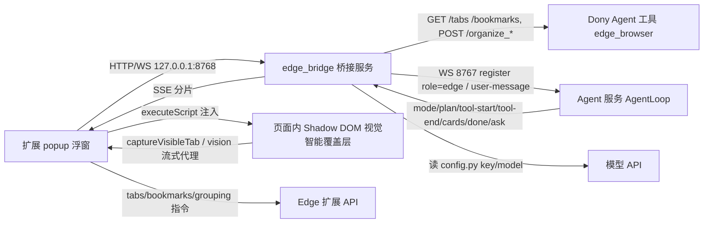

## Product Overview

为 intelligentStudio（APPXinteligent）新增一个 Edge 浏览器扩展（对应 configuser.txt 第 15 条「edge扩展插件」）。扩展以浮窗为入口，让用户在不唤醒全局界面的情况下，在浏览器内直接使用视觉智能，并直接发起标签页/收藏夹整理；同时由扩展向本机暴露数据与指令通道，使 Dony 能读取标签页、收藏夹、书签数据并执行整理。

## Core Features

- 浮窗内视觉智能：点击浮窗中的「视觉智能」后，当前网页进入暗化框选状态（框选内亮度正常、边缘高亮，可拖拽边缘调整范围）；确认后在选区下沿弹性飞入白色药丸选项（理解内容/翻译内容/提取文字/识别物体/搜索物体，各带线条提示图标与彩虹光效）。点击选项或输入自定义要求后，选区出现彩虹半透明流动光效，随后显示 AI 回答；回答框为圆角半透明黑底、渐变显示、可拖拽右下角缩放、内容可滚动；结果以「文字卡片」或「链接卡片」呈现，链接卡点击在浏览器中打开。确认输入后输入框边缘出现绕框旋转的加载白色光边，回答完成后光边消失、答案飞入。
- 本地数据 API（供 Dony 调用）：读取当前标签页数据（标题、网址、窗口/分组归属等）、收藏夹与书签内容；执行整理——重排/文件夹收纳收藏夹、按域名分组标签页、关闭重复标签页；返回执行结果摘要。
- 浮窗内整理：在浮窗内直接点击「整理标签页」「整理收藏夹」，把数据交给 Dony 后端进行整理并回流答复；执行过程按阶段呈现（判断模式、计划步骤、正在执行的操作名），结果以文字与卡片形式逐行飞入；若模型需要澄清或确认，浮窗内弹出询问输入框，回答后继续执行。
- 桥接状态与降级：浮窗显示本地桥接服务连接状态；未安装/未运行桥接服务时，读取类操作给出明确提示，不出现静默失败。

## Boundaries

- 不修改 `src/components/overlay/**`（视觉智能与 Dony 前端 UI、动画、交互），不修改 `VisualOverlay.tsx` 等源码，仅只读复用。
- 不修改 Dony 现有行为与动画；仅按已预留契约新增本地桥接服务并让 `edge_browser` 工具生效。
- 不修改主项目构建配置，不生成 plan.md。

## Tech Stack

- 扩展：Edge/Chromium Manifest V3 + React 18 + TypeScript + framer-motion 11，独立 `extension/` 工程自带 Vite 5 构建（产物 `extension/dist`，以「加载解压缩的扩展」方式使用）。不引入 UI 组件库，沿用项目自有 CSS 变量体系（`src/components/overlay/acrylic.css` 的 `--dony-*` 令牌）。
- 只读复用现有前端资产：`VisualOverlay.tsx`、`VisualOverlay.css`、`AcrylicLayer.tsx`、`ResultCards.tsx`、`RainbowGlow.tsx`、`RainbowEdges.tsx`、`src/components/overlay/rainbow/*`、`src/types.ts`。
- 桥接服务：Python + FastAPI/uvicorn + websockets + httpx（`backend/requirements.txt:6-8` 已具备，无需新增依赖），监听 `127.0.0.1:8768`，与 `backend/agent/config.py:124` 的 `EDGE_API_BASE` 契约一致。

## Implementation Approach

核心策略是「扩展只做浏览器能力与呈现，模型与整理判断全部走本机既有后端」，从而在不改动 Dony 与视觉智能任何源码的前提下完成三项功能。

1. **桥接服务 `backend/edge_bridge.py`（新增，8768，单端口同时承载 HTTP 与 WS）**，承担四类职责：

- 履约 Dony 已预留契约（`backend/agent/tools/uia_screen.py:836-854` 不可改动）：`GET /tabs`、`GET /bookmarks` 直接返回扩展最近上报的**快照缓存**；`POST /organize_tabs`、`POST /organize_bookmarks` 下发给扩展执行并回传结果摘要。读走缓存可避免「Agent 调 8768 → 8768 等扩展 → 扩展等 Agent」的请求-响应成环。
- 扩展通道：`/ext/ws` 承载扩展注册与心跳、标签页/收藏夹快照上报、指令下发与结果回传；注册时做最小 token 握手（服务端首次生成并落盘于用户配置目录，扩展在 popup 首次运行时读取/配对），比现有一律无鉴权、CORS 全开（`backend/main.py:12-18`、`dony_app_api.py:26-29`）更收敛。
- 视觉代理：`POST /vision/ask` 读取 `backend/agent/config.py` 的 `API_BASE/API_KEY`，模型取新增的 `VISION_MODEL`（环境变量 `OPENAI_VISION_MODEL` > `.appx_config.json` > 默认与全局视觉智能一致的模型名），以 SSE 流式回传模型分片；**密钥不出本机**，扩展内不保存任何密钥。
- 整理中继：以独立 WS 客户端身份连 `ws://127.0.0.1:8767`，`register(role="edge")`（`agent_server.py:16-29,72-73`，独立 Session 不影响 overlay 会话），发 `user-message` 触发整理；把出站事件 `mode / plan / tool-start / tool-end / cards / done / error`（`llm.py:723-852`）转推给扩展浮窗，把 `ask` 转给浮窗并将 `ask-response` 回填，使澄清与确认在浮窗内闭环。

2. **扩展侧适配层（不动原组件）**：`extension/src/adapter/electronShim.ts` 在扩展页面内 polyfill `window.electronAPI`。`VisualOverlay.tsx` 对 Electron 的依赖面仅 6 处（`captureScreen:517`、`onChatChunk:529`、`onChatEnd:534`、`onChatError:537`、`sendChatRequest:540`、`onVisualEscape:582`），逐一映射为：`chrome.tabs.captureVisibleTab` → 经 canvas **归一化到视口 CSS 像素**后返回 dataURL（关键正确性点：`cropFromScreen`（:338）按 `img.naturalWidth / img.width` 换算，若直接把 DPR 放大后的截图给它，框选裁剪会落在错误区域）；`sendChatRequest` → 请求桥接 `/vision/ask` 并把 SSE 分片重新派发为 `chat-chunk/chat-end/chat-error`；`onVisualEscape` → 覆盖层内 Esc 监听；`captureDesktop` → 同一张归一化截图（供亚克力底衬）；其余（`setVisualWindowRect`、`setVisualMousePassthrough`、`notifyState` 等）做无害化空实现。
3. **注入与样式隔离**：popup 点击「视觉智能」（用户手势 + `activeTab`）→ background 用 `chrome.scripting.executeScript` 注入内容脚本 → 内容脚本建 Shadow DOM 承载 React 根节点（`position: fixed; inset: 0`）。所需的 `VisualOverlay.css` 与彩虹样式以 `?inline` 方式导入并写入 shadow root，避免污染宿主页样式；`build.cssCodeSplit=false` 下额外产出的全局 CSS 资源在扩展中不被引用，无副作用。
4. **整理流程**：popup 的整理按钮 → 通知扩展先推送最新快照 → 调桥接 `POST /organize/{tabs|bookmarks}` → 桥接以 `user-message` 触发 Dony Agent（提示词已限定使用 `edge_browser` 工具）→ Agent 调用 `edge_browser` 时从桥接缓存取数据、需要写入时由桥接下发扩展执行 → 执行摘要回到 Agent → 终态 `done/cards` 经桥接流回浮窗呈现。
5. **最小侵入接入 Electron**：按既有服务范式（`electron/main.js:1019` 的启动清单、`isPortInUse:725`、异常重启 `:706-764`、`will-quit:1306`）新增桥接服务的启停，不改任何窗口、动画、快捷键、IPC 逻辑；`backend/agent/config.py` 仅新增 `EDGE_BRIDGE_PORT`、`VISION_MODEL` 两项，不动 `MODEL/API_KEY` 语义。

## Architecture Design



## Implementation Notes

- **性能**：快照上报只订阅 `chrome.tabs`/`chrome.bookmarks` 变更事件并做 300ms 去抖，不做常驻轮询；`GET /tabs`、`GET /bookmarks` 命中内存缓存，复杂度 O(n) 且不触发跨进程往返；视觉截图单次调用，裁剪在扩展侧本地 canvas 完成，不额外传输全屏图；覆盖层在 Esc/关闭时卸载 React 根并注销监听，不残留常驻定时器。
- **可靠性**：桥接服务未启动时，`/vision/ask` 与整理入口给出可读提示并允许重试；WS 断线按 1s/2s/4s 退避重连；Agent 的 `ask` 未被回答时按 `cancel` 收尾，避免会话悬挂；整理请求设超时，超时回传失败摘要而不阻塞下一次请求。
- **日志**：沿用 Python `print(..., flush=True)` 与扩展 console 的既有风格，只记录连接状态、action 名与耗时；不打印 API Key、完整标签页 URL 列表（只打条数），避免日志膨胀与隐私泄露。
- **改动面控制**：`src/**` 零改动；`electron/main.js` 仅新增启动/停止两段；`backend/agent/**` 仅 `config.py` 增两个配置项；不触碰 `uia_screen.py` 的 `edge_browser` 契约与 `agent_server.py` 的消息协议。
- **权限最小化**：manifest 仅声明 `tabs / bookmarks / scripting / activeTab / storage`，`host_permissions` 仅 `http://127.0.0.1:8768/*`；视觉智能依赖点击手势 + `activeTab`，不申请 `<all_urls>`。

## Directory Structure

```
APPXInteligent/
├── extension/
│   ├── package.json                    # [NEW] 扩展独立依赖（react/react-dom/framer-motion/vite/typescript）
│   ├── vite.config.ts                  # [NEW] MV3 多入口构建（background/content/popup），alias 指向 ../src 复用视觉组件
│   ├── tsconfig.json                   # [NEW] 扩展 TS 配置，paths 映射 @dony/* 到 ../src/*
│   ├── public/
│   │   ├── manifest.json               # [NEW] MV3 清单：权限、host_permissions、background、action popup、content_scripts 声明
│   │   └── icons/*.png                 # [NEW] 扩展图标，沿用项目 Logo 目录的视觉基调
│   └── src/
│       ├── background/index.ts         # [NEW] 注入内容脚本、快捷键/命令路由、指令执行器（关重复标签页、按域名分组、收藏夹重排/收纳）、快照采集与去抖上报
│       ├── bridge/client.ts            # [NEW] 8768 客户端：token 握手、WS 注册/心跳/退避重连、快照上报、指令收发、vision SSE 解析
│       ├── bridge/protocol.ts          # [NEW] 桥接与扩展消息类型定义（上报/指令/整理事件/询问）
│       ├── adapter/electronShim.ts     # [NEW] window.electronAPI 适配层；captureScreen 归一化到视口 CSS 像素；sendChatRequest 走 /vision/ask 并派发 chat-chunk/end/error
│       ├── content/visual.tsx          # [NEW] 内容脚本入口：Shadow DOM 根节点、?inline 样式注入、挂载 VisualOverlay、Esc 与卸载清理
│       ├── popup/index.html            # [NEW] popup 宿主页
│       ├── popup/main.tsx              # [NEW] popup 入口
│       ├── popup/Popup.tsx             # [NEW] 浮窗外壳：视图切换（主面板/整理/状态）、桥接状态、错误提示
│       ├── popup/panels/HomePanel.tsx  # [NEW] 主面板：视觉智能、整理标签页、整理收藏夹三个入口
│       ├── popup/panels/OrganizePanel.tsx # [NEW] 整理面板：要求输入、阶段进度（模式/计划/操作名）、结果卡片、打断询问输入
│       ├── popup/panels/StatusPanel.tsx# [NEW] 状态面板：桥接连接、模型信息、权限清单、加载步骤提示
│       ├── popup/components/*.tsx      # [NEW] 药丸按钮、彩虹描边卡片、日志行、卡片列表等复用件
│       └── popup/popup.css             # [NEW] 浮窗样式，复用 --dony-* 令牌与滚动条配色
├── backend/
│   ├── edge_bridge.py                  # [NEW] 8768 桥接服务：Dony 契约路由（/tabs /bookmarks /organize_*）、/ext/ws 扩展通道与 token 握手、/vision/ask 视觉流式代理、8767 整理中继（role=edge）与 ask 回填
│   └── agent/config.py                 # [MODIFY] 仅新增 EDGE_BRIDGE_PORT 与 VISION_MODEL（env > .appx_config.json > 默认），不动 MODEL/API_KEY/EDGE_API_BASE
└── electron/main.js                    # [MODIFY] 增量接入桥接服务启停（沿用 isPortInUse、异常重启、will-quit 清理范式）
```

## Key Code Structures

```ts
// extension/src/bridge/protocol.ts —— 桥接与扩展的契约（供 background/桥接服务双向实现）
export type ExtToBridge =
  | { type: 'register'; token?: string; version: string }
  | { type: 'heartbeat' }
  | { type: 'snapshot'; tabs: TabInfo[]; bookmarks: BookmarkInfo[] }
  | { type: 'command-result'; id: string; ok: boolean; detail: string }

export type BridgeToExt =
  | { type: 'registered'; token: string; ok: boolean }
  | { type: 'command';
      id: string
      action: 'tabs' | 'bookmarks' | 'organize_tabs' | 'organize_bookmarks'
      payload?: { closeDuplicateTabs?: boolean; groupByDomain?: boolean }
    }
  | { type: 'organize-event'; kind: 'mode' | 'plan' | 'tool-start' | 'tool-end' | 'cards' | 'done' | 'error'; data: unknown }
  | { type: 'ask'; id: string; kind: string; text: string }
```

```python
# backend/edge_bridge.py —— 对外暴露的关键路由（签名级）
# GET  /tabs                 -> 扩展上报的快照缓存（Dony edge_browser 契约，勿改语义）
# GET  /bookmarks            -> 同上
# POST /organize_tabs        -> 中继扩展执行：按域名分组 / 关闭重复标签页，返回执行摘要
# POST /organize_bookmarks   -> 中继扩展执行：重排 / 文件夹收纳收藏夹
# POST /vision/ask           -> SSE 流式代理模型（密钥仅在服务端）
# WS   /ext/ws               -> 扩展注册、快照上报、指令下发与结果回传
# WS   -> ws://127.0.0.1:8767 独立会话（role="edge"），承载浮窗内的整理流程与 ask 回填
```

## 设计定位

浏览器扩展浮窗（Chrome/Edge popup，桌面 web 场景，尺寸约 360×560，上限 800×600）。延续 intelligentStudio 的视觉语言：Apple Intelligence 式多色彩虹光效 + Windows 11 圆角 + 亚克力半透明材质，直接复用 `acrylic.css` 的 `--dony-*` 令牌，不加表情包，仅用圆角、纯文本、线条图标与克制的彩虹效果。动效遵循 configuser.txt 第 4 条：一律快速弹性动画，飞入一律「快速飞入 + 末尾减速缓冲」，禁止元素/文字出现、隐藏、缩放时无过渡。

## 页面规划（3 屏，同一 popup 内视图切换，不新开窗口）

### 1. 主面板

- 顶部品牌条：左侧线条图标 + 产品名，右侧圆形关闭/最小化控件；底边一条极细的流动彩虹描边。
- 功能入口区：三张药丸形入口卡片（视觉智能、整理标签页、整理收藏夹），左侧线条图标、右侧操作提示；悬停时卡片上浮 2px 并点亮彩虹描边。
- 快捷说明区：两行小字说明「视觉智能需在当前网页中使用」「整理由 Dony 执行」。
- 底部状态条：桥接服务连接状态点（已连接/未运行）+ 一行文本；未连接时整条变为警示配色并给出重试按钮。

### 2. 整理面板

- 顶部导航：返回箭头 + 标题（整理标签页 / 整理收藏夹），右侧为再次执行按钮。
- 要求输入区：药丸形输入框，默认填充「按域名分组并关闭重复标签页」或「按域名收纳收藏夹」，回车提交，输入时长度随文本增长。
- 执行进度区：按阶段逐行飞入的日志行（判断模式 / 计划步骤 / 正在执行的操作名），每行左侧一个小圆点，进行中带呼吸动效。
- 结果区：回答文字逐行飞入，下方卡片按主题色渐变（标签页蓝青、收藏夹紫粉），左侧内容、右侧线条图标。
- 打断询问区：需要澄清或确认时，结果区下方飞入输入框与「允许 / 不允许」两个药丸按钮，回答后沿原路径收束并继续执行。

### 3. 状态面板

- 连接卡片：桥接服务地址、连接状态、握手结果，配一行说明与「重新连接」按钮。
- 模型卡片：当前模型名与来源（仅展示，不显示密钥），提示密钥仅保存在本机。
- 权限清单：以线条图标逐条列出已授予权限及其用途。
- 加载指引：三行文本说明扩展的加载方式，等宽小字排版。
- 版本与日志入口：版本号与折叠式最近日志（最多 20 行滚动）。

### 页内覆盖层（复用，不重新设计）

视觉智能覆盖层直接复用现有组件与令牌：暗化遮罩、框选高亮与八向拖拽手柄、选区下沿飞入的五个白色药丸选项、彩虹输入框、绕框旋转的加载白色光边、圆角半透明回答框（可拖右下角缩放）、文字卡与链接卡。行为与全局视觉智能保持一致，仅承载环境由全屏窗口换成页面内 Shadow DOM。

## Agent Extensions

### Skill

- **rainbow-loading-pill**
- Purpose: 生成「彩虹流光输入框/胶囊」+「沿边框旋转的加载光边」成套 UI
- Expected outcome: 浮窗内的药丸输入框、入口卡片与整理面板的彩虹描边，以及视觉覆盖层确认输入后的旋转加载光边，均按参数化方式产出并与全局视觉智能观感一致
- **animate**
- Purpose: 为浮窗动效确定工具、属性、曲线与时长，并写出实现
- Expected outcome: 入口卡片悬停、面板切换、日志与结果逐行飞入、询问框进出等动效均为快速弹性曲线且末尾减速缓冲，符合 configuser.txt 第 4 条
- **apple-design**
- Purpose: 校验材质、层次、排版与可中断过渡是否符合 Apple 式观感
- Expected outcome: 亚克力半透明层次、彩虹光边克制使用、字号与行距、深浅色适配整体一致，无廉价感

### SubAgent

- **code-explorer**
- Purpose: 精确定位可只读复用的视觉智能组件、样式与调用面
- Expected outcome: 明确 `VisualOverlay.tsx`、`ResultCards.tsx`、`rainbow/*`、`acrylic.css`、`src/types.ts` 的引用路径与 6 处 `window.electronAPI` 依赖，确保适配层覆盖完整且不改动任何原文件