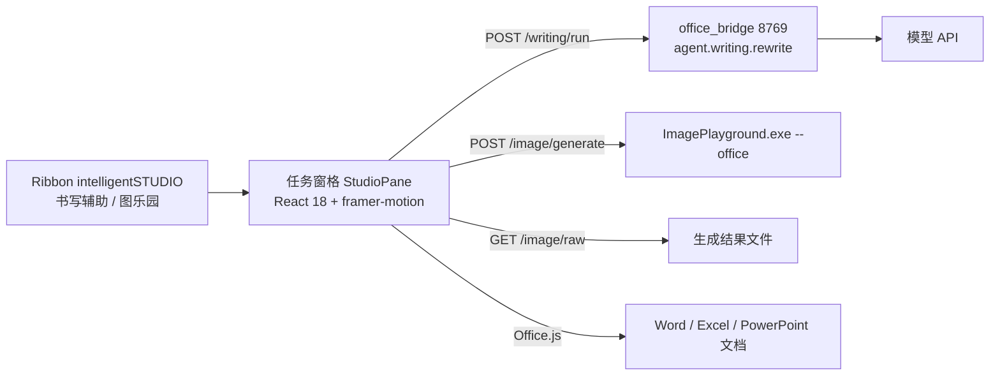

## 产品概述

在 Word、Excel、PowerPoint 顶部的功能区新增一个自定义选项卡「intelligentSTUDIO」，其中提供两个大按钮：书写辅助与图乐园。点击按钮后，右侧任务窗格进入相应功能页；功能页左上角有「返回」，可回到选择页重新选择。

## 核心功能

**选择页**

- 两张入口卡片：书写辅助、图乐园，大图标 + 名称 + 一行说明。
- 底部一行状态：本地服务已连接或未启动，未启动时提供重试。

**书写辅助**

- 自动读取当前选中文本（Word 选区、Excel 选区单元格、PowerPoint 选中文本框）；未选中时显示空状态「在文档中选中文字后再开始」并提供重新读取。
- 七个动作：校对、改写、友好、正式、简洁、列表、表格；不提供摘要与要点。
- 一段自定义要求输入（彩虹药丸输入框），回车即执行。
- 结果先预览、不直接改文档；结果卡下方提供四个按钮：复原（把原文写回）、按住看原文、保留（替换文档原文，主按钮）、复制。
- 处理中：所选动作按钮边框出现沿边旋转的彩色光边；文档保持原样。

**图乐园**

- 单行 5 个可见元素气泡，左右滑动可浏览全部元素；选中后边缘显示彩虹细边并轻微弹入，再点一次取消。
- 只允许一段文字描述（单行彩虹药丸输入框），旁边一个小按钮「读取上下文」：自动把光标附近文字压成一段填入输入框，用户可改。
- 一个画风选择（胶囊下拉）与一个「生成」按钮。
- 点「生成」的瞬间就在文档光标处插入一张占位图（灰底细边 + 六边形 + 一句说明），尺寸与成品一致；窗格内同时出现多个小气泡向中心融合成一个球，球内六边形每秒转一格。
- 生成完成后，文档中同一位置、同一尺寸换成成品图；窗格内球展开为图卡，提供「插入」「再生成」「下载」。
- 失败时占位图变为失败样式并给出原因，窗格内提供「重试」「移除」；取消生成则删除占位图，不留残留。

## 视觉要求

浅色、克制、细线：白色卡片 + 1px 极细边 + 柔和投影；彩虹只作点缀，出现在输入框描边、动作按钮的处理中光边、加载六边形上，不大面积铺色。所有出现、隐藏、形变都有过渡，飞入为快速起步加末尾减速，不做生硬的瞬间显隐。窗格宽度从 280 到 520 都能正常阅读，窄时动作由三列降为两列。

## 技术选型

| 层 | 选择 | 理由 |
| --- | --- | --- |
| 加载项形态 | Office Web Add-in（XML 清单 + Office.js） | 一套 UI 覆盖 Word/Excel/PowerPoint；任务窗格即「无窗口只有 UI 控件」形态；与现有 React 栈一致 |
| 前端 | React 18 + TypeScript + Vite + framer-motion | 与仓库既有 `extension/` 子包同构，动效库已在用 |
| 本地服务 | FastAPI `backend/office_bridge.py`，127.0.0.1:8769 | 沿用 `backend/edge_bridge.py` 的 token、SSE、单端口范式 |
| 改写 | 复用 `backend/agent/writing.py` 的 `ACTIONS` 与 `rewrite()` | 桌面端与 Office 端措辞、温度、工具调用约束完全一致 |
| 生图 | 复用 `playground-app/Services/OfficeCommandLine.cs` 的 `--office` 契约 | 已有静默调用入口，无窗口、无端口、退出码 + stdout JSON |
| 图标 | 新增脚本从 `Logo/*.ico` 导出 16/32/80 PNG | Ribbon 只接受 PNG 三档尺寸 |


## 实现思路

**1. 清单：一个自定义选项卡 + 两个大按钮**

XML 清单官方限制「Add-ins are limited to one custom tab」，因此不做两个选项卡。清单声明 `Document` / `Workbook` / `Presentation` 三宿主，`Permissions` 取 `ReadWriteDocument`，`Requirements` 分别声明 `AddinCommands 1.1`、`WordApi 1.3`、`ExcelApi 1.9`、`PowerPointApi 1.1`。`CustomTab` 内两个 `Group`，各放一个按钮；子元素顺序必须是 `Group` → `Label` → `InsertAfter`，顺序错会校验失败。

**2. 导航：单窗格、query 定位、首页兜底**

两个按钮的 `ShowTaskpane` 共用同一个 `TaskpaneId`（`StudioPane`），`SourceLocation` 分别为 `taskpane.html?mode=writing` 与 `?mode=playground`。窗格启动读 `mode`：有值则直接进对应功能页，无值则落在选择页。这样即使某版本复用窗格时没有重新导航，最坏结果只是多一次点击，不会报错。功能页的「返回」把内部状态复位到选择页，不重载文档。

**3. 宿主适配层：唯一接触 Office.js 的地方**

`src/host/` 下按宿主分文件，统一一个窄接口（读取选区文本、读取附近文本、替换文本、插入占位图、替换占位图、删除占位图、能力探测）。三处差异必须内建：

- Word：`Range.insertText(text, "Replace")` 替换；占位图用 `Range.insertContentControl()` 打 `tag`，再用 `ContentControl.insertInlinePictureFromBase64(base64, "Replace")` 原位换图；表格用 `insertTable`。
- Excel：选中文本取 `getSelectedRange().values`；替换写回 `range.values`；图片用 `shapes.addImage`（1.9+），`shape.name` 作定位句柄，`shape.placement = "MoveAndSize"`；**没有像素级 Range→矩形 API**，left/top 需按列宽、行高（points）累加，替换时复用原 left/top/width/height 再 `delete` 重建；「表格」直接写二维区域。
- PowerPoint：文本取 `getSelectedShapes()` 的 `textFrame.textRange.text`；图片优先 `setSelectedDataAsync(base64, { coercionType: Image })`，按 `isSetSupported` 探测后再考虑 `shapes.addImage`；命名同样依赖 `shape.name`；**无建表 API**，「表格」降级为要点列表并在按钮上标注不可用原因。

能力不满足时按钮禁用并给一句原因，不允许「点了没反应」。

**4. 占位图链路（图乐园核心）**

`jobId` 是唯一标识：`dony:img:<jobId>`。点击生成时立即用本地 base64 占位图插入，零网络等待；窗格内记录 jobId 与目标尺寸。完成时按 jobId 定位，原位替换，并显式沿用占位尺寸，避免文档重排。原则是**文档内静态、窗格内动态**：不用定时替换图片来刷进度（会污染撤销栈、让文档闪烁），进度只在窗格表现。

**5. 图片体积**

图片只能以 base64 插入。1024 PNG 的 base64 可达 1.5–3MB，`context.sync()` 会明显卡顿。窗格拿到原图后先用 canvas 降采样到约 640px 宽、转 JPEG q0.85，压到 200–400KB 再交给 Office.js；传给 `insertInlinePictureFromBase64` 时去掉 `data:` 前缀。

**6. 彩虹输入框复用**

不复制组件：`office/vite.config.ts` 用 `@dony/` 别名指向 `../src`，与 `extension/vite.config.ts` 的既有做法一致，直接引用 `src/components/overlay/rainbow/rainbow.css` 与 `rainbowPill.ts`。任务窗格需改三处参数：`computeGeometry` 的 `room` 由 60 降到 14（否则出血被窗格边缘裁掉）、线宽 2–3px、模糊标准差 1.5–2.2；`.rb-pill-surface` 的 `backdrop-filter` 在 iframe 里糊不到文档，改为自绘材质（白色渐变 + 内高光 + 外细边）；`@property` 需回退分支（Safari 16.4 之前不生效）。中文输入法 `compositionstart` 到 `compositionend` 之间不响应 Enter。

**7. 桥接口**

静态托管 `office/dist` 与 API 同源，免 CORS；`x-dony-token` 沿用 edge_bridge 的落盘 token 机制，窗格内不带任何密钥。三个接口：`POST /writing/run`（非流式，复用 `rewrite`，因此进度用不确定态而不是假流式）、`POST /image/generate`（起 `ImagePlayground.exe --office`，返回文件路径）、`GET /image/raw?job=`（同源取字节，供窗格降采样）。`GET /image/context` 把附近文本交给模型产出一段画面描述填回输入框。

性能要点：`rewrite` 单次耗时由模型决定（超时沿用 `WRITING_TIMEOUT`），窗格必须有可取消语义；元素目录 60 项一次性加载 JSON，气泡用虚拟滚动或惰性图片；生图进程冷启动约 1–2 秒，占位图负责遮住这段空窗。



## 目录结构

```text
APPXInteligent/
├── office/                                  # [NEW] 加载项前端子包（与 extension/ 同构）
│   ├── manifest.xml                         # [NEW] 三宿主清单：一个 CustomTab、两个大按钮、共用 StudioPane
│   ├── package.json                         # [NEW] react 18 / framer-motion 11 / vite 5，复用根 node_modules
│   ├── tsconfig.json                        # [NEW] 严格模式，path 别名 @dony/* 指向 ../src
│   ├── vite.config.ts                       # [NEW] base './'、@dony 别名、react 单副本 dedupe（照 extension 写法）
│   ├── assets/icons/{16,32,80}/             # [NEW] 由 Logo/*.ico 导出的 Ribbon PNG，文件名 writing.png / playground.png
│   └── src/
│       ├── index.html                       # [NEW] 窗格入口，注 office.js CDN（或本地副本），viewport 禁缩放
│       ├── main.tsx                         # [NEW] 挂载 + Office.onReady 后再渲染，避免读宿主时拿到 null
│       ├── App.tsx                          # [NEW] 两级导航：route = home | writing | playground，读 ?mode= 初始化
│       ├── styles/tokens.css                # [NEW] 颜色/字号/圆角/动效时长变量，含 prefers-reduced-motion 分支
│       ├── styles/office.css                # [NEW] 窗格布局：身份条固定、内容滚动、输入区贴底；280/350/520 三档断点
│       ├── api/client.ts                    # [NEW] fetch 封装 + token 读取 + 取消信号 + 统一错误文案映射
│       ├── host/office.ts                   # [NEW] 宿主探测、模式分派、能力探测缓存
│       ├── host/types.ts                    # [NEW] SelectionInfo / InsertResult / Capabilities 类型
│       ├── host/word.ts                     # [NEW] 选区、附近段落、insertText 替换、contentControl 占位图链路、insertTable
│       ├── host/excel.ts                    # [NEW] 选区值读写、列宽行高累加算 left/top、shapes.addImage 与按 name 替换
│       ├── host/powerpoint.ts               # [NEW] 选中形状文本、setSelectedDataAsync 插图、按 name 替换、表格降级
│       ├── components/IdentityBar.tsx       # [NEW] 返回按钮 + 功能名 + 宿主徽标，40px 固定高
│       ├── components/RainbowPill.tsx       # [NEW] 彩虹药丸输入框，内部用 @dony/rainbow 的 rb-pill 结构，处理 IME
│       ├── components/ActionGrid.tsx        # [NEW] 七个动作的三列/两列网格，working 时按钮带旋转光边
│       ├── components/ResultCard.tsx        # [NEW] 结果正文 + 复原/按住看原文/保留/复制，照搬 ActionBar 语义
│       ├── components/BubbleRow.tsx         # [NEW] 单行 5 个可见元素气泡，横向滑动、选中彩虹细边与弹入
│       ├── components/GeneratingOrb.tsx     # [NEW] 多泡泡向中心融合 + 六边形每秒一转
│       ├── pages/Home.tsx                   # [NEW] 两张入口卡片 + 连接状态 + 重试
│       ├── pages/Writing.tsx                # [NEW] 书写辅助状态机：idle/ready/working/preview/applied
│       └── pages/Playground.tsx             # [NEW] 图乐园状态机：idle/working/done/failed，持有 jobId 与占位尺寸
├── backend/
│   ├── office_bridge.py                     # [NEW] 8769：token、静态托管 office/dist、书写、生图、raw 取字节、上下文建议
│   └── agent/config.py                      # [MODIFY] 新增 OFFICE_BRIDGE_PORT（env > cfg > 8769）与 OFFICE_STATIC_DIR
├── scripts/
│   ├── make-office-icons.py                 # [NEW] 从 Logo/书写辅助.ico、Logo/图乐园.ico 导出 16/32/80 PNG（Pillow）
│   └── install-office-addin.ps1             # [NEW] 写 HKCU WEF\Developer 清单路径、清 Office/WebView2 缓存、导入本地证书
└── settings-app/Services/ExtensionInstallService.cs   # [不改] 已预留调用，脚本就位后自动可用
```

## 关键契约

```ts
export interface HostAdapter {
  readonly host: 'word' | 'excel' | 'powerpoint'
  readSelection(): Promise<{ text: string; empty: boolean }>
  readContext(): Promise<string>
  replaceText(original: string, next: string): Promise<void>
  insertPlaceholder(jobId: string, w: number, h: number): Promise<void>
  replacePlaceholder(jobId: string, jpegBase64: string): Promise<boolean>
  removePlaceholder(jobId: string): Promise<void>
  supports(action: string): { ok: boolean; reason?: string }
}
```

## 实施注意

- 不改 `backend/agent/writing.py` 的 `ACTIONS`：桌面端仍依赖 `summary` / `keypoints`，Office 端只在 UI 层不展示。
- 不把 `window.electronAPI`、`AcrylicLayer`、`SnapshotContext` 带进窗格；`AcrylicLayer` 依赖桌面壁纸快照，在 iframe 中不成立。
- 不在文档正文上尝试绘制彩虹层（Office.js 无覆盖层能力），彩虹只存在于窗格内。
- 清单内所有 URL 必须 HTTPS，且静态资源响应不得带 CACHE-CONTROL 指令（Office 需要缓存图片）。
- 占位图与成品图宽高比必须一致，替换后显式沿用占位尺寸，否则文档会重排。
- 生图失败不留灰色空图：失败态占位图必须提供「移除」。
- 日志沿用 `print(..., flush=True)` 的 `[office-bridge]` 前缀风格，不打印 token 与完整 base64。

## 设计风格

延续项目既有语言：浅色、克制、细线、彩虹只作点缀。任务窗格是窄而长的密集界面，不做大幅留白与大幅动画，靠 1px 细边、字号层级与极短过渡建立秩序。所有形变使用 spring，飞入使用 `cubic-bezier(0.23,1,0.32,1)`，时长 0.18–0.26s；彩虹只在 hover、激活、处理中三种状态出现。

## 窗格骨架

固定三段：40px 身份条（不随滚动）、中间滚动内容、底部贴底输入区。宽度 280–520 自适应；小于 340 时动作网格由三列降为两列，元素气泡间距收紧到 6px，身份条标题省略中间一段。

## 页面一：选择页

1. 身份条：应用图标 18px + 「intelligentSTUDIO」+ 右侧宿主徽标（Word/Excel/PowerPoint 文字胶囊）。无返回按钮。
2. 入口卡区：两张 96px 高卡片上下排列，圆角 14，白底 + 1px `#00000010` 边。左侧 44px 图标容器（内放对应 Logo），右侧标题 15/600 与一行说明 12/400。hover 时卡片上移 1px、细边渐显彩虹、图标轻微上浮 2px。
3. 连接状态条：一行 12px 文字，左侧 6px 圆点（连通绿色、未连通灰色），未连通时右侧出现「重试」文本按钮。
4. 页脚：版本号与一句「在文档中选中文字后可直接使用书写辅助」的提示，13px 次级色。

## 页面二：书写辅助

1. 身份条：左返回（24px 圆形按钮 + 左箭头线条图标）+ 「书写辅助」+ 宿主徽标。
2. 当前文本卡：圆角 12 白卡，标题行「当前文本」12/500 次级色，正文 13/400 行高 1.55，超过 5 行折叠并给「展开」。空态居中三行：一句说明 + 「重新读取」文本按钮。
3. 动作矩阵：七个动作三列网格，单元高 44、圆角 10、12.5/500 标签 + 18px 线条图标上下叠放。处理中：该单元边缘出现彩虹旋转光边，其余单元降透明度到 0.55，不接收点击。不可用的动作（如 PowerPoint 的表格）显示为禁用并可从标签下方小字读到原因。
4. 底部输入区：彩虹药丸输入框（高 40、圆角全圆），左侧六边形描边图标，右侧发送圆钮；聚焦时彩虹描边不透明度提高，输入时描边缓慢流动。占位文字「描述修改要求」。
5. 结果卡（条件出现，自下而上 8px 弹入，替代动作矩阵占位）：标题行（动作名 + 一行说明）+ 正文区（最大高 180 可滚）+ 按钮组。按钮组顺序与桌面横框一致：左「复原」、中「按住看原文」（按住时在卡内浮层显示原文）、右「保留」为主按钮，最右「复制」。保留后底部状态行显示「已替换，Ctrl+Z 可撤销」，3 秒淡出。

## 页面三：图乐园

1. 身份条：返回 + 「图乐园」+ 宿主徽标。
2. 元素条：单行 5 个 44px 圆形气泡（元素缩略图 + 1px 细边），横向滚动浏览全部；选中时外圈彩虹细边 2px、气泡放大到 1.06 并轻微下弹；顶部右侧显示「已选 2」的小计数。
3. 描述区：彩虹药丸输入框（单行）+ 右侧 28px 圆形「读取上下文」按钮（线条图标，点击后输入框内容整体替换并轻微高亮一次）。
4. 画风与生成行：画风用胶囊下拉（高 32，圆角全圆，白底细边），生成按钮为胶囊主按钮，激活时描边彩虹流动；生成中变为「取消」。
5. 状态区：生成中显示融合泡泡（3 个小圆滑向中心合并成一球，球内六边形每秒转一格，球下 12px 文字「正在生成…」）；完成时球以 spring 展开为 4:3 图卡（圆角 12，图下三个按钮：插入、再生成、下载）；失败时为灰底细边卡片，标题「生成未完成」+ 一行原因 + 「重试」「移除」。

## Agent Extensions

### Skill

- **rainbow-loading-pill**
- Purpose: 移植「彩虹流光药丸 + 沿边框旋转加载光边」到任务窗格，并按窄窗格重新标定几何参数
- Expected outcome: 书写辅助的自定义要求输入框、图乐园的描述输入框、动作按钮的处理中光边三处共用同一套组件，`room`、线宽、模糊半径给出适配窗格的一组确定值

- **apple-design**
- Purpose: 校准两级导航的转场、按钮按压反馈、占位图替换与图卡展开的空间一致性，以及 reduced-motion 降级
- Expected outcome: 一套可直接写入 `tokens.css` 的动效令牌（时长、曲线、spring 参数）与三条降级规则

- **apple-hig-writing**
- Purpose: 统一界面文案：按钮动词化（保留/复原/插入/生成）、空状态、错误信息、禁用原因、输入框占位
- Expected outcome: 一份按屏幕分组的文案表，含错误与空态的完整措辞，并核对与桌面端既有术语一致