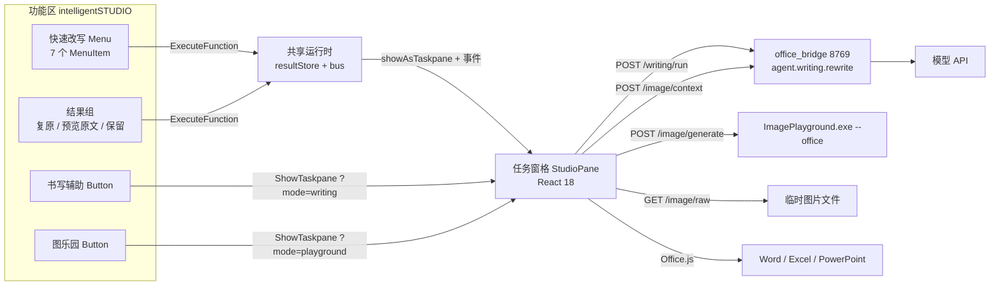

## 产品概述

在 Word、Excel、PowerPoint 的功能区新增一个自定义选项卡「intelligentSTUDIO」，将部分操作做成功能区内的一键按钮，右侧任务窗格承担需要展示与输入的完整流程。窗格为单实例、两级导航：选择页 → 书写辅助 / 图乐园 → 返回。

## 核心功能

**功能区（intelligentSTUDIO 选项卡，三组共五个控件，全部大图标）**

- 组「快速改写」：一个下拉菜单，含校对、改写、友好、正式、简洁、列表、表格七项。点击即改写文档中选中文本，不先开面板，可用 Ctrl+Z 撤销；未选中文字时唤起窗格并说明原因。
- 组「工作室」：两个大按钮「书写辅助」「图乐园」，打开任务窗格并直达对应功能页。
- 组「结果」：三个大按钮「复原」「预览原文」「保留」，与窗格结果卡共享同一份状态。保留把结果写入文档；复原在待定时取消本次、在已写入时把原文写回；预览原文唤起窗格并在结果卡内呈现原文（功能区不显示浮层）。无待定结果时按钮仍可点击，由窗格给出一行说明，不出现「点不动的灰按钮」。

**选择页**

- 两张入口卡片（书写辅助 / 图乐园），大图标 + 名称 + 一行说明。
- 底部一行本地服务连接状态，未连通时提供「重试」。

**书写辅助**

- 自动读取当前选中文本（Word 选区、Excel 选区单元格、PowerPoint 选中文本框）；未选中时给出空状态与「重新读取」。
- 七个动作：校对、改写、友好、正式、简洁、列表、表格，不提供摘要与要点。
- 一段自定义要求输入，使用彩虹药丸输入框（白色磨砂面 + 底下的流动彩虹光晕），回车即执行；提交中描边缓慢流动。
- 结果先预览、不改文档；结果卡下方四个按钮：复原、按住看原文（按住时卡内浮层显示原文，松开回到结果）、复制、保留（主按钮）。
- 处理中所选动作按钮边缘出现沿边旋转的彩色光边，其余按钮降透明度并暂停接收点击。

**图乐园**

- 单行 5 个元素气泡，一屏即全部；选中后边缘出现彩虹细边并轻微下落回弹，再点一次取消。
- 只允许一段文字描述，使用同一款彩虹药丸输入框；旁侧一个「读取上下文」小按钮：把光标附近文字交给模型，由模型改写为一段可直接生图的画面描述，回填输入框并标注「已按上下文改写」，用户可再编辑。
- 画风胶囊下拉与「生成」胶囊按钮同排；生成中按钮变为「取消」。
- 点「生成」的瞬间就在文档光标处插入一张与成品同尺寸的占位图（灰底细边 + 六边形 + 一句说明），窗格内出现一条 2px 细进度条（不确定态滑动高光）与阶段文字。
- 生成完成后同位置、同尺寸替换为成品图；窗格内图卡提供「插入」「再生成」「下载」。
- 失败时占位图变为失败样式并给出原因，可「重试」或「移除」；取消生成则删除占位图，不留残留。

## 视觉要求

浅色克制：白色卡片 + 1px 极细边 + 柔和投影，靠字号层级与间距建立秩序。彩虹只作点缀，仅出现在输入框光晕、处理中光边、进度条高光与加载六边形上，不大面积铺色。文档内的占位图是唯一视觉载体，不在正文上叠加任何动画层。窗格宽度 280 至 520 都能正常阅读，窄时收紧间距、动作由四列降为三列。所有出现、隐藏、形变都有过渡；飞入为快速起步加末尾减速。

## 技术选型

| 层 | 选择 | 理由 |
| --- | --- | --- |
| 加载项形态 | Office Web Add-in，XML 清单 + Office.js | 一套 UI 覆盖 Word/Excel/PowerPoint；任务窗格即「无窗口只有 UI 控件」形态 |
| 清单版本 | `VersionOverrides` 用 `V1_1`，启用共享运行时 | 功能区 `ExecuteFunction` 无 UI 宿主，必须靠共享运行时唤起窗格并共享状态 |
| 前端 | React 18 + TypeScript + Vite 5 + framer-motion 11，独立子包 `office/` | 与仓库 `extension/` 子包同构；动效库已在用 |
| 样式 | 纯 CSS + CSS 变量，不引入 Tailwind | 必须直接复用 `src/components/overlay/rainbow/rainbow.css` 的 `.rb-pill` / `.rb-edge` 整套变量与 keyframes，再叠一层工具类会形成两套样式体系 |
| 本地服务 | FastAPI `backend/office_bridge.py`，127.0.0.1:8769（HTTPS） | 沿用 `backend/edge_bridge.py` 的 token、Origin 白名单、单端口范式 |
| 改写 | 复用 `backend/agent/writing.py` 的 `ACTIONS` 与 `rewrite()` | 桌面端与 Office 端措辞、温度、工具调用约束完全一致 |
| 生图 | 复用 `playground-app/Services/OfficeCommandLine.cs` 的 `--office` 契约 | 已有静默入口，无窗口、无端口、退出码 + stdout JSON |
| 图标 | 新增脚本从 `Logo/*.ico` 导出 16/32/80 PNG | 功能区只接受 PNG 三档尺寸 |


## 实现思路

### 1. 功能区「直改」，窗格「需要看与需要输入」

功能区受清单能力约束：只有 `Button` 与 `Menu`，没有输入框、开关、复选框，因此自定义要求、结果预览、图乐园的元素与画风只能留在窗格。功能区动作的执行路径是：读写选区 → `POST /writing/run` → 直接写回文档 → 静默成功（可撤销）。为让进度与错误有承载，清单启用共享运行时（`<Runtimes><Runtime resid="..." lifetime="long"/></Runtimes>`，`FunctionFile` 与窗格同 URL），动作在失败或空选时 `Office.addin.showAsTaskpane()` 唤起窗格并投递一条事件；不支持共享运行时的宿主降级为隐藏运行时静默直改。

### 2. 三个结果按钮的双处同步

`resultStore` 是唯一状态源，存放在共享运行时的模块单例里，功能区（`ExecuteFunction`）与窗格（React）读写同一份：

```ts
export interface ResultState {
  status: 'idle' | 'preview' | 'applied'
  action?: string          // proofread / rewrite / ...
  handle?: string          // 宿主定位句柄
  original?: string        // 原文（复原用）
  next?: string            // 结果（保留用）
}
```

状态变化后若 `Office.context.requirements.isSetSupported('RibbonApi','1.1')` 为真，调 `Office.ribbon.requestUpdate()` 刷新三按钮 `enabled`；不支持时不调用，按钮保持可用，点击后由窗格给一行说明。窗格订阅 `resultStore`，功能区与窗格永远显示同一个按钮可用性。

### 3. 宿主适配层是唯一接触 Office.js 的地方

统一窄接口，按宿主分文件；定位句柄的设计直接决定「复原」与「占位图替换」是否可靠：

- Word：文本用 `Range.insertContentControl()` + `tag = dony:txt:<jobId>` 作句柄，替换走 `insertText(text,"Replace")`，复原按 tag 找回并写回原文；图片同机制 `tag = dony:img:<jobId>`，`ContentControl.insertInlinePictureFromBase64(base64,"Replace")` 原位换图；表格用 `insertTable`。
- Excel：文本记 `sheetName + address` 并备份原 `values` 用于复原；图片用 `shapes.addImage`（ExcelApi 1.9+），`shape.name = dony:img:<jobId>`、`placement = "MoveAndSize"`；无像素级 Range→矩形 API，`left/top`（points）按列宽行高累加；替换时记录原 `left/top/width/height` → `delete()` → 同参重建。
- PowerPoint：文本记 `slideId + shapeId` 与原文；图片优先 `setSelectedDataAsync(base64, { coercionType: Office.CoercionType.Image })`，随后取 `getSelectedShapes()` 命名并设尺寸；无建表 API，「表格」禁用并在标签下方注明原因。

### 4. 上下文生图 = 上下文 → 模型 → 提示词 → 生图

`POST /image/context` 把宿主上下文（Word 光标前后各一段、Excel 选区邻域、PPT 选中形状文本 + 备注）交给模型，提示词要求：输出一段 40 至 80 字的画面描述，只写画面内容，不解释、不加引号、不加 Markdown、不出现文字水印与界面元素，贴合当前画风。返回后回填输入框并标注来源。需要提示的是 `PromptComposer.Compose` 在 `RawPrompt` 有值时会忽略 `Elements/Texts`，所以元素名必须拼进整段描述，`--elements` 与 `--prompt` 不能同时传。

### 5. 占位图链路

`jobId` 贯穿：点生成瞬间用本地 base64 占位图插入（零网络等待），窗格记录 `jobId` 与目标尺寸；完成按 `jobId` 定位原位替换，显式沿用占位尺寸避免重排；失败换失败态占位图（可移除）；取消删除。原则是文档内静态、窗格内动态，绝不用定时替换图片刷进度。

### 6. 图片体积

图片只能以 base64 插入，1024 PNG 的 base64 可达 1.5 至 3MB，`context.sync()` 会明显卡顿。窗格从 `GET /image/raw?job=` 取字节 → canvas 降到约 640px 宽、JPEG q0.85（200 至 400KB）→ 去 `data:` 前缀后交 Office.js。

### 7. 彩虹药丸按 skill 落地

以仓库既有的 skill 移植 `@dony/rainbow`（`rainbow.css` + `rainbowPill.ts`）为载体，逐项对照 skill 核对，不另造几何：

- 尺寸真源是 `--rb-w` / `--rb-h`，圆角传 `height/2`（胶囊）；`room` 由 60 降到 14，否则出血被窗格边缘裁掉；线宽 2 至 3px、模糊 `stdDeviation` 1.5 至 2.2。
- 层次必须为：`.rb-edge`（z0）→ `.rb-pill::before` 彩虹底层（z-1）→ `.rb-pill-surface` 磨砂面（z1）→ 内容（z3）；`.rb-pill` 保留 `isolation: isolate`。
- `.rb-pill-surface` 的 `backdrop-filter` 在 iframe 里糊不到文档，改为自绘材质：白色竖向渐变 + `inset 0 1px 0` 内高光 + 1px 外细边。
- `@property` 提供回退分支（旧 Safari 不支持角度动画时改用静态 conic 描边）；`prefers-reduced-motion` 下光边停转、彩虹静态。
- 提交中加 `.is-active` 亮起光边，结束移除；中文输入法 `compositionstart` 到 `compositionend` 之间不响应 Enter。

### 8. 桥的接口与安全

同源托管 `office/dist`（免 CORS）；校验 `Origin == https://localhost:8769` 与请求头 `x-dony-token`（token 落盘沿用 `store.DONY_DIR` 约定，即 `%APPDATA%\Dony`，并在 HTML 模板中注入，避免额外握手）；静态响应不加 `Cache-Control`（Office 需要缓存图标）。接口：`POST /writing/run`、`POST /image/generate`、`GET /image/raw?job=`、`POST /image/context`、`POST /image/cancel`、`GET /image/elements`。

### 9. 进度条（替代泡泡融合）

不确定态：2px 轨道（`#00000010` 圆角）+ 28% 宽彩虹渐变光条 1.6s 循环 `translateX(-100% → 380%)`，下方 12px 阶段文字依次为「提交请求 / 正在生成 / 取回图像 / 写入文档」。完成时收敛并 120ms 淡出，图卡 spring 弹入。减少动态效果时改为静态 40% 条 + 透明度呼吸。

## 架构



## 目录结构

```text
APPXInteligent/
├── office/                                   # [NEW] 加载项子包（与 extension/ 同构）
│   ├── manifest.xml                          # [NEW] 三宿主清单：一个 CustomTab、三组五控件、共享运行时、RibbonApi 要求
│   ├── package.json                          # [NEW] react 18 / framer-motion 11 / vite 5；脚本 build、dev、icons
│   ├── tsconfig.json                         # [NEW] 严格模式；@dony/* 指向 ../src；verbatimModuleSyntax 关闭
│   ├── vite.config.ts                        # [NEW] base './'、@dony 别名、react 单副本与 dedupe（照 extension 写法）
│   ├── public/icons/{16,32,80}/              # [NEW] writing.png / playground.png / quick.png / restore.png / preview.png / keep.png
│   └── src/
│       ├── index.html                        # [NEW] 窗格入口；注入 token；引 office.js；禁缩放 viewport
│       ├── main.tsx                          # [NEW] Office.onReady 后挂载；注册 Office.actions.associate 与 Ribbon 刷新
│       ├── App.tsx                           # [NEW] 路由 home|writing|playground，读 ?mode=，负责返回与事件订阅
│       ├── bus.ts                            # [NEW] 运行时内单例事件总线（功能区动作 → 窗格）
│       ├── resultStore.ts                    # [NEW] 三按钮状态源 + requestUpdate 触发
│       ├── styles/tokens.css                 # [NEW] 颜色/字号/圆角/时长/缓动；reduced-motion 与 reduced-transparency 分支
│       ├── styles/pane.css                   # [NEW] 三段式骨架、280/340/520 断点、rb-pill 材质覆写
│       ├── api/client.ts                     # [NEW] fetch 封装、token 注入、AbortSignal、错误文案映射
│       ├── api/image.ts                      # [NEW] 生成/取图/取消/上下文/元素清单 + canvas 降采样
│       ├── host/types.ts                     # [NEW] SelectionInfo、Capabilities、HostAdapter
│       ├── host/index.ts                     # [NEW] 宿主探测与分派（Office.context.host）
│       ├── host/word.ts                      # [NEW] 选区/上下文/contentControl 文本与图片句柄/insertTable
│       ├── host/excel.ts                     # [NEW] 选区值与备份/列宽行高定位/shapes.addImage 与按 name 替换/二维写表
│       ├── host/powerpoint.ts                # [NEW] 选中形状文本/setSelectedDataAsync 插图/按 name 替换/表格降级
│       ├── components/IdentityBar.tsx        # [NEW] 返回按钮 + 功能名 + 宿主胶囊，40px 固定
│       ├── components/RainbowPill.tsx        # [NEW] 彩虹药丸输入框，两处共用；IME 保护、Enter 提交、is-active 光边
│       ├── components/ActionGrid.tsx         # [NEW] 七动作网格；working 时该格光边、其余降透明禁点
│       ├── components/ResultCard.tsx         # [NEW] 结果正文 + 复原/按住看原文/复制/保留，接 resultStore
│       ├── components/BubbleRow.tsx          # [NEW] 5 个 44px 元素气泡，选中彩虹细边 + 落弹
│       ├── components/ProgressBar.tsx        # [NEW] 2px 不确定态进度条 + 阶段文字
│       ├── components/StatusLine.tsx         # [NEW] 一行状态/错误/成功，3 秒淡出
│       ├── pages/Home.tsx                    # [NEW] 两张入口卡 + 连接状态 + 重试
│       ├── pages/Writing.tsx                 # [NEW] idle/ready/working/preview/applied；接功能区 quick 事件
│       └── pages/Playground.tsx              # [NEW] idle/working/done/failed；持有 jobId、占位尺寸、阶段
├── backend/
│   ├── office_bridge.py                      # [NEW] 8769：token+Origin 校验、静态托管、书写、上下文、生图、取图、取消、元素清单
│   └── agent/config.py                       # [MODIFY] 新增 OFFICE_BRIDGE_PORT(8769)、OFFICE_STATIC_DIR、PLAYGROUND_EXE
├── scripts/
│   ├── make-office-icons.py                  # [NEW] Logo/*.ico → 16/32/80 PNG（Pillow，LANCZOS + 透明处理）
│   └── install-office-addin.ps1              # [NEW] 信任本地证书、复制清单、写 HKCU WEF\Developer、清缓存、-Uninstall
└── package.json                              # [MODIFY] 增 office:build / office:icons / office:install
```

## 关键契约

```ts
export type HostName = 'word' | 'excel' | 'powerpoint'

export interface HostAdapter {
  readonly host: HostName
  readSelection(): Promise<{ text: string; empty: boolean; handle: string }>
  readContext(): Promise<string>
  replaceText(handle: string, original: string, next: string): Promise<void>
  restoreText(handle: string, original: string): Promise<void>
  insertPlaceholder(jobId: string, widthPx: number, heightPx: number): Promise<void>
  replacePlaceholder(jobId: string, jpegBase64: string): Promise<boolean>
  removePlaceholder(jobId: string): Promise<void>
  supports(action: string): { ok: boolean; reason?: string }
}
```

## 实施注意

- 不改 `backend/agent/writing.py` 的 `ACTIONS`：桌面端仍依赖 `summary` / `keypoints`，Office 端只在 UI 层不展示。
- 功能区菜单顺序与窗格动作顺序、文案同源（校对/改写/友好/正式/简洁/列表/表格）。
- 清单内 URL 必须 HTTPS；`CustomTab` 子元素顺序 `Group` → `Label` → `InsertAfter`，组内 `Label`/`Icon` → `Control`；每组不超过 3 个控件以保住大图标。
- 占位图与成品宽高比一致，替换后显式沿用占位尺寸。
- 生图进程冷启动 1 至 2 秒，占位图必须即时插入遮住空窗；`/image/cancel` 终止子进程，失败退化为「放弃等待 + 删除占位图」。
- 日志沿用 `print(..., flush=True)` 的 `[office-bridge]` 前缀；不打印 token、base64 与整段提示词。

## 设计风格

浅色、克制、细线。窗格是窄而长的密集界面，不做大留白与大幅动画，靠 1px 细边、字号层级与 120 至 260ms 的过渡建立秩序。彩虹只作点缀，出现在输入框光晕、处理中光边、进度条高光与加载六边形四处。

## 骨架

固定三段：40px 身份条（不随内容滚动，左侧返回 + 标题 + 宿主文字胶囊）、中间滚动内容、底部贴底输入区。宽度 280 至 520 自适应；小于 340 时动作格间距收紧到 8px、气泡间距 6px、标题省略到 4 字。

## 页面一：选择页

1. 身份条：18px 应用图标 + 「intelligentSTUDIO」+ 右侧宿主胶囊，无返回按钮。
2. 两张 96px 入口卡上下排列，圆角 14，白底 + 1px `#00000010` 边、`0 1px 3px rgba(0,0,0,.05)` 投影。左侧 44px 图标容器，右侧标题与一行说明。悬停上移 1px、细边渐显彩色、图标上浮 2px；按下缩放到 0.985。
3. 连接状态条：6px 圆点（连通绿、未连通灰）+ 一行 12px 说明；未连通时右侧出现「重试」文本按钮。
4. 页脚 12px 次级色：「在文档中选中文字后可直接使用书写辅助」。

## 页面二：书写辅助

1. 身份条：24px 圆形返回按钮 + 箭头线条图标 + 「书写辅助」+ 宿主胶囊。
2. 当前文本卡：圆角 12 白卡，标题行 12/500 次级色，正文 13/400 行高 1.55，超 5 行折叠并给「展开」。空态居中一句说明 + 「重新读取」。
3. 动作矩阵：七动作网格，单元高 44、圆角 10，18px 线条图标与 12.5/500 标签上下叠放。处理中该格出现沿边彩虹光边，其余格透明度 0.55 且不接收点击。宿主不支持的动作禁用，标签下方 10px 小字给出原因。
4. 自定义要求：彩虹药丸输入框，高 40，左侧六边形描边图标，右侧发送圆钮，占位「描述修改要求」；聚焦时描边不透明度提高，提交时光边亮起。
5. 结果卡：自下而上 8px 弹入，标题行（动作名 + 一句改动说明）+ 正文区（最大高 180 可滚）+ 按钮组：复原（线条撤销图标）、按住看原文（眼睛图标，按住时卡内浮层显示原文）、复制、保留（主按钮，实心深色）。保留后状态行显示「已替换，Ctrl+Z 可撤销」并在 3 秒后淡出。

## 页面三：图乐园

1. 身份条：返回 + 「图乐园」+ 宿主胶囊。
2. 元素条：5 个 44px 圆形气泡一行排开，缩略图 + 1px 细边；选中时外圈 2px 彩虹细边、放大 1.06 并轻微下落回弹；右上角「已选 2」小字计数。
3. 描述行：彩虹药丸输入框（单行，占位「描述想要的画面」）+ 右侧 28px 圆形「读取上下文」按钮；模型回填时输入框整体轻微高亮一次，下方一行小字标注「已按上下文改写」。
4. 画风行：胶囊下拉（高 32，白底细边）与「生成」胶囊主按钮同排；生成中变为「取消」。
5. 进度区：2px 细轨道 + 28% 宽彩虹渐变光条循环滑动，下方 12px 阶段文字；完成时收敛淡出，4:3 图卡 spring 展开（圆角 12，图下「插入」「再生成」「下载」）。
6. 失败态：灰底细边卡片，标题「生成未完成」+ 一行原因 + 「重试」「移除」。

## 动效令牌

出现 180ms、飞入 240ms（`cubic-bezier(0.23,1,0.32,1)`）、隐藏 160ms；形变与图卡展开用 spring（`stiffness 420 / damping 34`）；气泡落弹允许轻微过冲（`bounce 0.18`）；状态行 3 秒后 200ms 淡出。减少动态效果时：光边停转、进度条静止、飞入改为 160ms 淡入 + 4px 位移。

## Agent Extensions

### Skill

- **rainbow-loading-pill**
- Purpose: 按该 skill 的几何与层次规范，把「彩虹流光药丸 + 沿边旋转加载光边」落到窄任务窗格，用于书写辅助的自定义要求输入框与图乐园的描述输入框。
- Expected outcome: 一处 `RainbowPill` 组件两处复用；`room`、线宽、模糊半径给出适配窗格的一组确定值；`.rb-edge` 位于磨砂面之下、四层同一条虚线、dash 按真实路径长度计算；补齐 `@property` 回退与 `prefers-reduced-motion` 降级。

- **apple-design**
- Purpose: 校准两级导航转场、按压反馈、结果卡与图卡展开的空间一致性，以及占位图替换时的视觉连续性。
- Expected outcome: 一套可直接写入 `tokens.css` 的动效令牌与三条降级规则；进入与退出走同一条路径；同一时刻最多两处在动。

- **apple-hig-writing**
- Purpose: 统一功能区与窗格的全部用户可见文案：按钮动词化、空状态、错误信息、禁用原因、输入框占位与「已按上下文改写」这类补充说明。
- Expected outcome: 一份按界面分组的文案表，覆盖空态、失败态与禁用原因的完整措辞，术语与桌面端一致（校对/改写/友好/正式/简洁/列表/表格、保留/复原）。