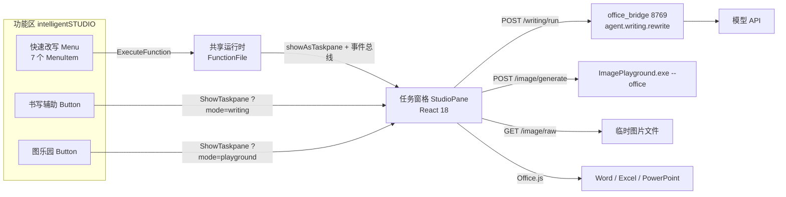

## 产品概述

在 Word、Excel、PowerPoint 的功能区（Ribbon）新增一个自定义选项卡「intelligentSTUDIO」：组内提供快速改写下拉与两个入口大按钮；右侧任务窗格承担需要展示与输入的辅助流程。窗格为单实例、两级导航：选择页 → 书写辅助 / 图乐园 → 返回。

## 核心功能

- 功能区「快速改写」下拉：校对、改写、友好、正式、简洁、列表、表格。点击即改写文档选中文本，不先开面板；可 Ctrl+Z 撤销。未选中文字时唤起窗格并提示。
- 功能区「书写辅助」「图乐园」两个大按钮：打开任务窗格并直达对应功能页；功能页左上「返回」回到选择页。
- 选择页：两张入口卡片（书写辅助 / 图乐园），底部一行本地服务连接状态，未连通时提供「重试」。
- 书写辅助页：展示当前选中文本（Word 选区、Excel 选区、PowerPoint 选中文本框），未选中时给出空状态与「重新读取」；七个动作网格；单行彩虹药丸输入自定义要求；结果先预览不改文档，底部四个按钮为复原、按住看原文、保留（主）、复制；处理中所选动作按钮出现沿边旋转的彩色光边。
- 图乐园页：5 个元素气泡（一屏即全部）；单行文字描述 + 「读取上下文」小按钮（把光标附近文字压成一段填入，可改）；画风胶囊与「生成」按钮同排；点生成瞬间在文档光标处插入与成品同尺寸的占位图，窗格显示一条 2px 细进度条与阶段文字；完成后同位置替换为成品图，图卡提供插入、再生成、下载；失败时占位图变失败态并给出原因，可重试或移除；取消则删除占位图。
- 全局：窗格宽度 280–520 自适应，窄时收紧间距；所有出现、隐藏、形变均有过渡，飞入为快速起步加末尾减速。

## 视觉要求

浅色克制：白色卡片 + 1px 极细边 + 柔和投影，字号层级建立秩序。彩虹只作点缀，仅出现在输入框描边、动作按钮处理中光边、进度条高光与加载六边形上，不大面积铺色。文档内的占位图是唯一视觉载体，不做覆盖层动画。

## 技术栈

- 加载项形态：Office Web Add-in，XML 清单（`CustomTab` 一个、两个组、共 3 个控件 → 全部显示大图标），`VersionOverrides` 用 V1.1 并启用共享运行时。
- 前端：React 18 + TypeScript + Vite 5 + framer-motion 11，独立子包 `office/`，依赖解析与 `extension/vite.config.ts` 同构（`@dony/` 别名指向 `../src`、React 单副本 + dedupe）。
- 样式：沿用仓库既有的纯 CSS + CSS 变量，不引入 Tailwind。原因是必须直接复用 `src/components/overlay/rainbow/rainbow.css`（`.rb-pill` / `.rb-edge` 一整套 CSS 变量与 keyframes），再叠加一层工具类会造成两套样式体系并存。
- 本地服务：FastAPI `backend/office_bridge.py`（127.0.0.1:8769，HTTPS），沿用 `backend/edge_bridge.py` 的 token、Origin 白名单、单端口范式。
- 复用：`backend/agent/writing.py` 的 `ACTIONS` 与 `rewrite()`；`playground-app/Services/OfficeCommandLine.cs` 的 `--office` 契约。

## 实现思路

### 1. 功能区承载「直改」，窗格承载「需要看与需要输入」

功能区的 `ExecuteFunction` 没有界面宿主，失败无人可见。因此功能区动作的职责收敛为「直改 + 快速反馈」：读选区 → 调 `POST /writing/run` → 直接写回。为让进度与错误有承载，清单启用共享运行时（`<Runtimes><Runtime resid="..." lifetime="long"/></Runtimes>`，`FunctionFile` 与窗格同 URL）。动作执行顺序是：`Office.addin.showAsTaskpane()` → 通过同一 runtime 的模块单例事件总线把 `{type:'quick', action}` 交给窗格 → 由窗格执行完整流程（含进度、错误、撤销说明）。Office 版本不支持共享运行时时降级为隐藏运行时静默直改，成功仍可撤销。

不放到功能区的：自定义要求输入（清单只支持 Button 与 Menu，没有输入框）、结果预览、复制、图乐园（需要 5 个元素与画风选择）。

### 2. 单窗格两级导航

两个按钮共用 `TaskpaneId` = `StudioPane`，`SourceLocation` 分别为 `taskpane.html?mode=writing` 与 `?mode=playground`。窗格启动读 `mode`，有值直接进功能页，无值落选择页——即使某版本复用窗格时未重新导航，最坏只是多点一次，不会出错。

### 3. 宿主适配层：唯一接触 Office.js 的地方

统一窄接口，按宿主分文件；定位句柄的设计直接决定「复原」与「占位图替换」能否可靠：

- Word：文本用 `Range.insertContentControl()` + `tag = dony:txt:<jobId>` 作句柄，替换走 `insertText(text,"Replace")`，复原按 tag 找回并写回原文；图片同机制，`tag = dony:img:<jobId>`，`ContentControl.insertInlinePictureFromBase64(base64,"Replace")` 原位换图；表格用 `insertTable`。
- Excel：文本记 `sheetName + address` 并备份原 `values` 用于复原；图片用 `shapes.addImage`（ExcelApi 1.9+），`shape.name = dony:img:<jobId>`、`placement = "MoveAndSize"`；无像素级 Range→矩形 API，left/top 按列宽行高（points）累加；替换时记录原 left/top/width/height → `delete()` → 同参重建。
- PowerPoint：文本记 `slideId + shapeId` 与原文；图片优先 `setSelectedDataAsync(base64, { coercionType: Office.CoercionType.Image })`，随后取 `getSelectedShapes()` 命名并设尺寸；无建表 API，「表格」禁用并给出原因。

### 4. 占位图链路

`jobId` 贯穿：点生成瞬间用本地 base64 占位图插入（零网络等待），窗格记录 jobId 与目标尺寸；完成按 jobId 定位原位替换，显式沿用占位尺寸避免重排；失败换失败态占位图（可移除）；取消删除。原则是文档内静态、窗格内动态，绝不用定时替换图片刷进度。

### 5. 图乐园提示词组装（已核实的关键约束）

`GenerationRequest.RawPrompt` 有值时 `PromptComposer` 会忽略 `Elements/Texts`，只追加风格后缀。因此不能同时传 `--elements` 与 `--prompt`。方案：窗格从 `Assets/Elements/manifest.json` 取 5 个元素的 `name/prompt/file`，生成时把已选元素名拼进整段描述，只传 `--prompt` 与 `--style`；不复用 `--elements`，也不改桌面端 C#。

### 6. 图片体积与降采样

图片只能以 base64 插入，1024 PNG 的 base64 可达 1.5–3MB，`context.sync()` 会明显卡顿。窗格从 `GET /image/raw?job=` 取字节 → canvas 降到约 640px 宽、JPEG q0.85（200–400KB）→ 去 `data:` 前缀后交 Office.js。

### 7. 彩虹药丸与光边的窗格标定

复用 `@dony/rainbow`：`computeGeometry` 的 `room` 由 60 降到 14（否则出血被窗格边缘裁掉）、线宽 2–3px、模糊 stdDeviation 1.5–2.2；`.rb-pill-surface` 的 `backdrop-filter` 在 iframe 里糊不到文档，改为自绘材质（白色渐变 + 内高光 + 外细边）；`@property` 提供回退分支；`compositionstart/end` 之间不响应 Enter；`prefers-reduced-motion` 停止光边旋转。

### 8. 桥的接口与安全

同源托管 `office/dist`（免 CORS）；校验 `Origin == https://localhost:8769` 且请求头 `x-dony-token` 匹配落盘 token（token 在 HTML 模板中注入，避免额外握手）；静态响应不加 `Cache-Control`（Office 需要缓存图标）。HTTPS 用安装脚本生成的自签名证书，导入本机受信任根（安装器已需管理员权限，见需求 16）。

### 9. 进度条（替代泡泡融合）

不确定态：2px 轨道 + 28% 宽彩虹渐变条 `translateX(-100% → 380%)` 循环 1.6s，下方 12px 阶段文字依次为「提交请求 / 正在生成 / 取回图像 / 写入文档」。完成时进度条宽度收敛并 120ms 淡出，图卡 spring 弹入。减少动态效果时改为静态 40% 条 + 透明度呼吸。



## 目录结构

```text
APPXInteligent/
├── office/                                   # [NEW] 加载项子包（与 extension/ 同构）
│   ├── manifest.xml                          # [NEW] 三宿主清单：一个 CustomTab、两组三控件、共享运行时、Set 版本要求
│   ├── package.json                          # [NEW] react 18 / framer-motion 11 / vite 5；脚本 build、dev(watch)、icons
│   ├── tsconfig.json                         # [NEW] 严格模式；@dony/* 指向 ../src；verbatimModuleSyntax 关闭
│   ├── vite.config.ts                        # [NEW] base './'、@dony 别名、React 单副本与 framer-motion dedupe（照 extension 写法）
│   ├── public/icons/{16,32,80}/              # [NEW] writing.png / playground.png / quick.png，由脚本从 Logo/*.ico 导出
│   └── src/
│       ├── index.html                        # [NEW] 窗格入口；注入 token 占位；引 office.js
│       ├── main.tsx                          # [NEW] Office.onReady 后再挂载，注册 Office.actions.associate
│       ├── App.tsx                           # [NEW] 路由 home|writing|playground，读 ?mode=，管理返回与共享事件总线
│       ├── bus.ts                            # [NEW] runtime 内单例事件总线（功能区动作 → 窗格）
│       ├── styles/tokens.css                 # [NEW] 颜色/字号/圆角/时长/缓动变量，含 reduced-motion 与 reduced-transparency 分支
│       ├── styles/pane.css                   # [NEW] 三段式骨架（固定身份条、滚动内容、贴底输入区）、280/340/520 断点
│       ├── api/client.ts                     # [NEW] fetch 封装、token 注入、AbortSignal、错误文案映射
│       ├── api/image.ts                      # [NEW] 生成/取图/取消/上下文/元素清单；canvas 降采样
│       ├── host/types.ts                     # [NEW] SelectionInfo、Capabilities、HostAdapter 类型
│       ├── host/index.ts                     # [NEW] 宿主探测与分派（Office.context.host）
│       ├── host/word.ts                      # [NEW] 选区/前后段落/文本替换复原/contentControl 占位图/insertTable
│       ├── host/excel.ts                     # [NEW] 选区值与备份/列宽行高累加定位/shapes.addImage 与按 name 替换/二维写表
│       ├── host/powerpoint.ts                # [NEW] 选中形状文本/setSelectedDataAsync 插图/按 name 替换/表格降级
│       ├── components/IdentityBar.tsx        # [NEW] 返回按钮 + 功能名 + 宿主徽标，40px 固定
│       ├── components/RainbowPill.tsx        # [NEW] 彩虹药丸输入框（复用 @dony/rainbow），IME 保护、Enter 提交
│       ├── components/ActionGrid.tsx         # [NEW] 七动作 4 列网格；working 时该格沿边光边、其余降透明并禁点
│       ├── components/ResultCard.tsx         # [NEW] 结果正文 + 复原/按住看原文/保留/复制，按住显示原文浮层
│       ├── components/BubbleRow.tsx          # [NEW] 5 个 44px 元素气泡，选中彩虹细边 + 落弹
│       ├── components/ProgressBar.tsx        # [NEW] 2px 不确定态进度条 + 阶段文字（替代泡泡融合）
│       ├── components/StatusLine.tsx         # [NEW] 一行状态/错误/成功提示，3 秒淡出
│       ├── pages/Home.tsx                    # [NEW] 两张入口卡 + 连接状态 + 重试
│       ├── pages/Writing.tsx                 # [NEW] 状态机 idle/ready/working/preview/applied；接功能区 quick 事件
│       └── pages/Playground.tsx              # [NEW] 状态机 idle/working/done/failed；持有 jobId、占位尺寸、阶段
├── backend/
│   ├── office_bridge.py                      # [NEW] 8769：token+Origin 校验、静态托管 office/dist、/writing/run、/image/*
│   └── agent/config.py                       # [MODIFY] 新增 OFFICE_BRIDGE_PORT(8769)、OFFICE_STATIC_DIR、PLAYGROUND_EXE
├── scripts/
│   ├── make-office-icons.py                  # [NEW] Logo/*.ico → 16/32/80 PNG（Pillow，含 LANCZOS 缩放与白底透明处理）
│   └── install-office-addin.ps1              # [NEW] 自签名证书导入、复制清单、写 HKCU WEF\Developer、清缓存、-Uninstall
└── package.json                              # [MODIFY] 增加 office:build / office:icons / office:install 三个脚本入口
```

## 关键契约

```ts
export type HostName = 'word' | 'excel' | 'powerpoint'

export interface HostAdapter {
  readonly host: HostName
  readSelection(): Promise<{ text: string; empty: boolean; handle: string }>
  readContext(): Promise<string>
  replaceText(handle: string, original: string, next: string): Promise<void>
  restoreText(handle: string, original: string): Promise<void>
  insertPlaceholder(jobId: string, widthPx: number, heightPx: number): Promise<void>
  replacePlaceholder(jobId: string, jpegBase64: string): Promise<boolean>
  removePlaceholder(jobId: string): Promise<void>
  supports(action: string): { ok: boolean; reason?: string }
}
```

```xml
<!-- 两个按钮共用一个 TaskpaneId，query 区分落点；两组共 3 个控件 → 全部大图标 -->
<CustomTab id="TabIntelligentStudio">
  <Group id="GroupQuick">
    <Label resid="GroupQuick.Label"/>
    <Icon><bt:Image size="16" resid="Icon.Quick.16"/><bt:Image size="32" resid="Icon.Quick.32"/><bt:Image size="80" resid="Icon.Quick.80"/></Icon>
    <Control xsi:type="Menu" id="MenuQuick">
      <Label resid="MenuQuick.Label"/>
      <Icon><bt:Image size="16" resid="Icon.Quick.16"/><bt:Image size="32" resid="Icon.Quick.32"/><bt:Image size="80" resid="Icon.Quick.80"/></Icon>
      <Items>
        <Item id="QrProofread"><Label resid="Qr.Proofread"/><Action xsi:type="ExecuteFunction"><FunctionName>qrProofread</FunctionName></Action></Item>
        <Item id="QrTable"><Label resid="Qr.Table"/><Action xsi:type="ExecuteFunction"><FunctionName>qrTable</FunctionName></Action></Item>
      </Items>
    </Control>
  </Group>
  <Group id="GroupStudio">
    <Label resid="GroupStudio.Label"/>
    <Icon><bt:Image size="16" resid="Icon.Quick.16"/><bt:Image size="32" resid="Icon.Quick.32"/><bt:Image size="80" resid="Icon.Quick.80"/></Icon>
    <Control xsi:type="Button" id="BtnWriting">
      <Label resid="BtnWriting.Label"/>
      <Icon><bt:Image size="16" resid="Icon.Writing.16"/><bt:Image size="32" resid="Icon.Writing.32"/><bt:Image size="80" resid="Icon.Writing.80"/></Icon>
      <Action xsi:type="ShowTaskpane"><TaskpaneId>StudioPane</TaskpaneId><SourceLocation resid="Pane.Writing"/></Action>
    </Control>
    <Control xsi:type="Button" id="BtnPlayground">
      <Label resid="BtnPlayground.Label"/>
      <Icon><bt:Image size="16" resid="Icon.Playground.16"/><bt:Image size="32" resid="Icon.Playground.32"/><bt:Image size="80" resid="Icon.Playground.80"/></Icon>
      <Action xsi:type="ShowTaskpane"><TaskpaneId>StudioPane</TaskpaneId><SourceLocation resid="Pane.Playground"/></Action>
    </Control>
  </Group>
  <Label resid="Tab.Label"/>
</CustomTab>
```

## 实施注意

- 不改 `backend/agent/writing.py` 的 `ACTIONS`：桌面端仍依赖 `summary`/`keypoints`，Office 端只在 UI 层不展示。
- 功能区 `Menu` 的 `MenuItem` 顺序与窗格动作顺序保持一致，文案同源（校对/改写/友好/正式/简洁/列表/表格）。
- 清单内所有 URL 必须 HTTPS；`CustomTab` 子元素顺序为 `Group` → `Label` → `InsertAfter`；组内顺序为 `Label`/`Icon` → `Control`。
- 占位图与成品宽高比一致，替换后显式沿用占位尺寸，否则文档重排。
- 生图进程冷启动 1–2 秒，占位图必须即时插入以遮住空窗；`/image/cancel` 直接终止子进程，失败则退化为「放弃等待 + 删除占位图」。
- 日志沿用 `print(..., flush=True)` 的 `[office-bridge]` 前缀；不打印 token、base64 与整段提示词。

## 设计风格

延续项目既有语言：浅色、克制、细线，彩虹只作点缀。任务窗格是窄而长的密集界面，不做大留白与大幅动画，靠 1px 细边、字号层级与 120–260ms 的过渡建立秩序。所有出现与隐藏都有过渡；飞入为快速起步加末尾减速 `cubic-bezier(0.23,1,0.32,1)`；按压反馈在 pointerdown 即发生（缩放 0.97）。

## 窗格骨架

固定三段：40px 身份条（不随内容滚动，左侧返回 + 标题 + 宿主文字胶囊）、中间滚动内容、底部贴底输入区。宽度 280–520 自适应；小于 340 时动作格间距收紧到 8px、气泡间距 6px、标题省略到 4 字。

## 页面一：选择页

1. 身份条：18px 应用图标 + 「intelligentSTUDIO」+ 右侧宿主胶囊。无返回。
2. 两张 96px 入口卡上下排列，圆角 14，白底 + 1px `#00000010` 边、`0 1px 3px rgba(0,0,0,.05)` 投影。左侧 44px 图标容器，右侧标题与一行说明。hover 上移 1px、细边渐显彩色、图标上浮 2px；按下缩放到 0.985。
3. 连接状态条：6px 圆点（连通为绿、未连通为灰）+ 一行 12px 说明；未连通时右侧出现「重试」文本按钮。
4. 页脚 12px 次级色：一句「在文档中选中文字后可直接使用书写辅助」。

## 页面二：书写辅助

1. 身份条：24px 圆形返回按钮 + 箭头线条图标 + 「书写辅助」+ 宿主胶囊。
2. 当前文本卡：圆角 12 白卡，标题行 12/500 次级色，正文 13/400 行高 1.55，超 5 行折叠并给「展开」。空态居中：一句说明 + 「重新读取」。
3. 动作矩阵：七动作 4 列网格，单元高 44、圆角 10，18px 线条图标与 12.5/500 标签上下叠放。处理中该格出现沿边彩虹光边，其余格透明度 0.55 且不接收点击。宿主不支持的动作禁用，标签下方 10px 小字给出原因。
4. 自定义要求：彩虹药丸输入框，高 40，左侧六边形描边图标，右侧发送圆钮，占位「描述修改要求」。聚焦时描边不透明度提高。
5. 结果卡：自下而上 8px 弹入，标题行（动作名 + 一句改动说明）+ 正文区（最大高 180 可滚）+ 按钮组：复原（线条撤销图标）、按住看原文（眼睛图标，按住时卡内浮层显示原文）、复制、保留（主按钮，实心深色）。保留后状态行显示「已替换，Ctrl+Z 可撤销」并在 3 秒后淡出。

## 页面三：图乐园

1. 身份条：返回 + 「图乐园」+ 宿主胶囊。
2. 元素条：5 个 44px 圆形气泡一行排开，缩略图 + 1px 细边；选中时外圈 2px 彩虹细边、放大 1.06 并轻微下落回弹；右上角「已选 2」小字计数。
3. 描述行：彩虹药丸输入框（单行，占位「描述想要的画面」）+ 右侧 28px 圆形「读取上下文」按钮；填入时输入框整体轻微高亮一次。
4. 画风行：胶囊下拉（高 32，白底细边）与「生成」胶囊主按钮同排；生成中按钮变为「取消」。
5. 进度区：2px 细轨道（`#00000010` 圆角）+ 28% 宽彩虹渐变光条 1.6s 循环滑动，下方 12px 阶段文字；完成时进度条收敛淡出，4:3 图卡 spring 展开（圆角 12，图下「插入」「再生成」「下载」）。
6. 失败态：灰底细边卡片，标题「生成未完成」+ 一行原因 + 「重试」「移除」。

## 动效令牌

出现 180ms、飞入 240ms（`cubic-bezier(0.23,1,0.32,1)`）、隐藏 160ms；形变与图卡展开用 spring（`stiffness 420 / damping 34`）；气泡落弹允许轻微过冲（`bounce 0.18`）；状态行 3 秒后 200ms 淡出。减少动态效果时：光边停转、进度条静止、飞入改为 160ms 淡入 + 4px 位移。

## Agent Extensions

### Skill

- **rainbow-loading-pill**
- Purpose: 把「彩虹流光药丸 + 沿边框旋转加载光边」移植到窄任务窗格，并按窗格宽度重新标定几何参数。
- Expected outcome: 书写辅助与图乐园的两个输入框、动作按钮的处理中光边共用同一套组件；`room`、线宽、模糊半径给出一组经窄窗格验证的确定值，且 `@property` 有回退实现。

- **apple-design**
- Purpose: 校准两级导航的转场、按压反馈、占位图替换与图卡展开的空间一致性，以及 reduced-motion 降级。
- Expected outcome: 一套可直接写入 `tokens.css` 的动效令牌（时长、曲线、spring 参数）与三条降级规则，并复核「进入与退出走同一条路径」。

- **apple-hig-writing**
- Purpose: 统一功能区与窗格的全部用户可见文案：按钮动词化、空状态、错误信息、禁用原因、输入框占位。
- Expected outcome: 一份按界面分组的文案表，覆盖空态、失败态与禁用原因的完整措辞，并与桌面端既有术语（校对/改写/友好/正式/简洁/列表/表格、保留/复原）保持一致。