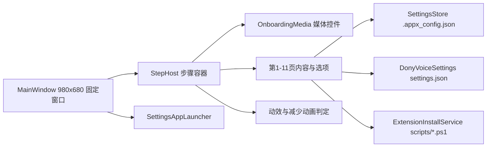

## 产品概述

为 intelligentSTUDIO 增加「软安装后首次启动」的欢迎与设置流程：一个独立的 WinUI3 窗口，以 11 页分步引导依次介绍 Dony、视觉智能、书写辅助、通知智能、照片编辑器、图乐园，并完成 Edge 扩展与 Office 插件的安装、四组模型配置，末页点击「完成」后退出引导并打开 STUDIO 设置。全程提供调试用 .bat 启动脚本，媒体素材先用占位，后续直接替换文件。

## 核心功能

- 固定 980×680 窗口，圆角 + Mica + 无系统标题栏，自绘左上「上一步」与右上关闭按钮。
- 首页之外、末页之前的每一页左上角显示「上一步」；首页与末页不显示。每页内容下方提供「继续」，末页为「完成」。
- 媒体呈现两态：框内（圆角卡片、四周留白、不贴边）与无框（上侧与左右延伸到窗口边缘）。视频进入页面自动静音播放，播放结束停在最后一帧，不显示播放控件。
- 页面结构统一：媒体区 → 左侧应用图标 + 右侧介绍 → 该页选项或操作 → 「继续」。
- 第 2 页 Dony：框内图片 + 朗读选项（关闭 / 始终朗读回复 / 仅在语音使用 Dony 时朗读回复）。
- 第 3 页视觉智能、第 4 页书写辅助、第 6 页照片编辑器：无框视频；第 4 页附「双击 Ctrl 启动书写辅助」开关。
- 第 5 页通知智能：框内图片 + 「通知智能」与「智能勿扰模式」两个开关。
- 第 7 页图乐园：无框图片。
- 第 8 页：介绍在浏览器中使用视觉智能、整理标签页与收藏夹，提供「安装 Edge 扩展」按钮。
- 第 9 页：介绍在 Office 中使用图乐园与书写辅助，提供「安装 Office 插件」按钮。
- 第 10 页模型配置：主模型、视觉模型、图像模型、编辑模型四组，各自填写接口地址、API 密钥、模型名称；图像与编辑模型含接口协议下拉；留空沿用上一组配置。
- 第 11 页：「欢迎使用 intelligentSTUDIO」文字飞入，点击「完成」后写入完成标记、退出本窗口并打开 STUDIO 设置；此页无「上一步」。
- 开关与选项点击即写入真实配置；模型配置点击「继续」时保存；安装按钮显示进度与结果提示，安装过程中仍可继续。
- 媒体素材缺失时显示占位视觉（彩虹渐变、图标与页码标题），不出现空白或异常，待素材提供后按约定文件名替换即可。
- 所有页面切换、元素出现均有短促、末尾减速的过渡，不做无动画的直接显示；遵循系统「减少动画」设置。
- 文案为书面语，动词化按钮标签，统一使用「继续」「上一步」「完成」，不使用「我们」、感叹号与表情符号。

## 技术栈

- 平台：WinUI 3（Windows App SDK 1.6.250205002）+ .NET 8（net8.0-windows10.0.19041.0），沿用现有工程口径：`WindowsPackageType=None`、`WindowsAppSDKSelfContained=true`、`Platforms=x64;ARM64`、`RuntimeIdentifier=win-x64`、PerMonitorV2 清单。
- UI：XAML 原生控件（Button、RadioButtons、ToggleSwitch、TextBox、PasswordBox、ComboBox、MediaPlayerElement、Image、InfoBar、ProgressRing、ScrollViewer），动效使用 Storyboard 与 Composition API（与 playground-app、photo-app 一致）。
- 工程新增目录 `onboarding-app/`，调试启动脚本 `run-onboarding.bat`，不改动既有四个 WinUI3 工程的行为。

## 实现方式

1. **单窗口 + 步骤容器**：MainWindow 承载固定尺寸窗体与自绘标题区；内容区由一个 `StepHost` 容器按索引切换视图，视图复用统一的「媒体区 + 标题介绍区 + 选项区 + 底部操作」骨架，页面只提供数据与选项内容，避免 11 份重复 XAML。
2. **媒体控件统一封装**：`OnboardingMedia` 暴露 `IsFramed`、`VideoFile`、`ImageFile`，内部判断素材是否存在：存在则视频用 `MediaPlayerElement`（关闭传输控件、静音、进入播放、`MediaEnded` 时暂停定帧），图片用等比填充并按需裁剪圆角；缺失则降级为占位视觉。素材按 `assets/onboarding/{dony,visual,writing,notifications,photo,playground}.{png,mp4}` 约定命名，csproj 以通配符复制到输出目录，后续替换文件即可生效。
3. **配置写入复用既有键**：其余页面复用 `settings-app/Services/SettingsStore.cs`（以 `<Compile Include="..\settings-app\Services\SettingsStore.cs" Link="..."/>` 方式链接源码），写入仓库根 `.appx_config.json`，键为 `WRITING_DOUBLE_CTRL`、`SMART_DND_ENABLED`、`NOTIFY_SUMMARY_ENABLED`、`OPENAI_*`、`IMAGE_*`、`EDIT_*`；扩展安装通过链接 `ExtensionInstallService.cs` 调用 `scripts/install-edge-extension.ps1`、`scripts/install-office-addin.ps1` 并解析 `STATUS=`/`REASON=`。语音朗读写入 `%APPDATA%\Dony\settings.json`（首次启动时 Dony 未必运行，不能依赖 8769 接口），由新增 `DonyVoiceSettings` 原子写入 `tts_enabled`/`tts_always`/`tts_voice_only`，语义与 `backend/agent/store.py`、`backend/dony_app_api.py` 一致：任一朗读开关开启即 `tts_enabled=true`。
4. **完成动作**：写入 `ONBOARDING_COMPLETED=true` 后，按仓库根查找 `settings-app/bin/x64/Debug/net8.0-windows10.0.19041.0/win-x64/DonySettings.exe` 启动；不存在时回退 `cmd /c run-onboarding…`→实际为 `run-settings-app.bat`；随后关闭本窗口。
5. **动效实现基调**：出页 90–110ms 淡出并轻微上移（EaseIn），入页 220–260ms `cubic-bezier(0.22, 1, 0.36, 1)` 位移 + 淡入，内容块 20ms 依次延迟；全部动画前检查 `new Windows.UI.ViewManagement.UISettings().AnimationsEnabled`（与 `dony-app/Controls/GlowChatBox.xaml.cs` 相同的既有写法），关闭时直接呈现终态。

### 性能与可靠性

- 6 个媒体页共用一个 `MediaPlayerElement` 实例，进入时设置 Source 并播放，离开时 `Pause` 并释放 Source，避免多实例占用解码管线造成首帧黑屏与内存增长。
- 页面视图首次进入时创建并缓存（11 个轻量视图），切换只改变可见性与位移，不重复构建控件树。
- 配置写入全部放在 UI 线程外或极短同步写内；`.appx_config.json` 与 `%APPDATA%\Dony\settings.json` 均采用「临时文件 + 覆盖」原子写，避免后端读到半截 JSON。
- 安装脚本调用沿用 `ExtensionInstallService` 的双通道读取（stdout/stderr 同时读）避免管道阻塞；按钮在等待期间禁用并显示 ProgressRing。

## 架构设计



## 目录结构

```
onboarding-app/
├── Onboarding.csproj            # [NEW] WinUI3 工程：自包含、非打包、ApplicationIcon 指向 assets/icons/intelligentSTUDIO.ico；链接 settings-app 的 SettingsStore.cs 与 ExtensionInstallService.cs；复制 assets/icons/*.ico 与 assets/onboarding/* 到输出目录
├── app.manifest                 # [NEW] PerMonitorV2 高 DPI 清单，复制 settings-app/app.manifest 结构
├── App.xaml                     # [NEW] 合并 XamlControlsResources；定义 RainbowBrush、OnboardingCardStyle、OnboardingTitleStyle、OnboardingSecondaryStyle（对齐 settings-app/App.xaml）
├── App.xaml.cs                  # [NEW] 单实例（AppInstance 键 Dony.Onboarding），激活后显示 MainWindow
├── MainWindow.xaml              # [NEW] 自绘标题区（左上「上一步」、右上关闭）、步骤容器、底部「继续/完成」；无系统标题栏，内容延伸到窗口边缘
├── MainWindow.xaml.cs           # [NEW] 980×680 固定尺寸（OverlappedPresenter 禁止缩放/最大化）、Mica、DWM 圆角（DwmSetWindowAttribute 33）、AppWindow.SetIcon、步骤索引与切换动画、完成流程
├── Controls/
│   ├── OnboardingMedia.xaml(.cs)      # [NEW] 媒体区：框内/无框两种布局；视频自动播放并在结束时定帧；素材缺失时占位视觉；离开页面释放播放器
│   └── ModelSettingsPanel.xaml(.cs)   # [NEW] 第 10 页四组模型表单（主/视觉/图像/编辑：地址、密钥、模型名，后两组带协议下拉），读取与保存 OPENAI_*/IMAGE_*/EDIT_*
├── Views/
│   ├── StepPage.xaml(.cs)       # [NEW] 通用页骨架：媒体区插槽 + 图标/标题/介绍 + 选项插槽 + 页脚说明
│   └── WelcomePage.xaml(.cs)    # [NEW] 第 11 页：欢迎文字飞入、「完成」按钮
├── Services/
│   ├── DonyVoiceSettings.cs     # [NEW] 读写 %APPDATA%\Dony\settings.json，三选项映射 tts_enabled/tts_always/tts_voice_only，保留未知键、原子写
│   ├── OnboardingState.cs       # [NEW] ONBOARDING_COMPLETED 标记读写（复用 SettingsStore）
│   ├── StepCatalog.cs           # [NEW] 11 页元数据：标题、介绍、图标、媒体文件与形态、选项类型、按钮标签
│   ├── InstallCoordinator.cs    # [NEW] 包装 ExtensionInstallService：运行状态、结果到提示文案的映射（沿用 GeneralPage 的措辞）
│   └── SettingsAppLauncher.cs   # [NEW] 定位并启动 DonySettings.exe，回退 run-settings-app.bat
└── Assets/                      # [NEW] 预留（素材统一放仓库 assets/onboarding/）

run-onboarding.bat               # [NEW] chcp 65001、按 EXE 是否存在决定 dotnet build -c Debug -p:Platform=x64、start "" EXE（对齐 run-settings-app.bat）
assets/onboarding/               # [NEW] 占位素材目录：dony.png、visual.mp4、writing.mp4、notifications.png、photo.mp4、playground.png
```

## 关键代码结构

```
// Controls/OnboardingMedia.xaml.cs —— 页面只描述素材，不关心框内/无框与降级
public sealed partial class OnboardingMedia : UserControl
{
    public bool IsFramed { get; set; }
    public string? VideoFile { get; set; }   // assets/onboarding/visual.mp4 等
    public string? ImageFile { get; set; }   // assets/onboarding/dony.png 等
    public void Play();                       // 进入页面：加载并播放；素材缺失则显示占位
    public void Stop();                       // 离开页面：暂停并释放 Source
}
```

## 实现注意

- 圆角裁剪：WinUI3 的 Border 不裁剪子元素，框内图片用 `ImageBrush` 背景实现圆角；框内视频与占位层用随 `SizeChanged` 更新的 `RectangleGeometry` Clip。
- 定帧可靠性：`MediaEnded` 后调用 `Pause()`，必要时把 `PlaybackSession.Position` 设到总时长前 1 帧再暂停，防止个别编码回跳到首帧。
- 无框页顶部按钮浮在媒体之上，需给「上一步」「关闭」加半透明底色与描边以保证对比度；标题与介绍文字用卡片或渐隐遮罩，避免压在亮画面上。
- 安装失败提示贴近按钮（InfoBar），文案给出可执行下一步，不出现脚本原始堆栈。
- 链接既有源码只读复用；不修改 settings-app 与 backend 的行为，避免影响已交付功能。

## 设计风格

沿用 Windows 11 Fluent 与 Apple Intelligence 的点缀语言：Mica 底、圆角卡片、纯文本与线性图标，彩虹渐变仅作强调（顶部细光条、图标描边、占位层），不做大面积彩色块。整体克制、留白充足，媒体是每页的视觉主体，文字与选项退到次级层级。

## 版式与页面结构

- 固定 980×680，内容分三段：媒体区（第 2–7 页）、标题介绍区、选项与操作区。上下留白 24，左右 32（无框页媒体区左右不留白）。
- 框内媒体：高 340，圆角 14，边框 1px `#14000000`，四周留白；无框媒体：高 400，贴住上、左、右三边，圆角仅底部 14。
- 标题介绍区：44×44 应用图标（圆角 10）+ 右侧 16 间距的标题（24 SemiBold）与 1–2 行介绍（13，次级灰，行高 20），整体左对齐、最大宽度 720。
- 选项区：ToggleSwitch 右对齐、标签与说明左对齐成两栏（标签 13 SemiBold，说明 12 次级灰）；朗读三选项用 RadioButtons 纵向排列，间距 8。
- 底部操作：右下「继续」128×36 主按钮（Accent），末页同位「完成」；左上「上一步」为无边框文字按钮带返回箭头，右上关闭为圆形图标按钮。
- 第 10 页无媒体，改为 2×2 卡片网格承载四组模型，卡片内字段纵向排列、间距 12，整块可滚动；第 11 页为垂直居中标题 + 下方「完成」。

## 动效（遵循快进末尾减速）

- 切页：出页 100ms 淡出 + 上移 8px；入页 240ms 位移 20px→0 + 透明度 0→1，缓动 `cubic-bezier(0.22, 1, 0.36, 1)`。
- 内容入场：图标、标题、介绍、选项、按钮依次延迟 20ms，位移 12px 淡入，单段 220ms。
- 末页文字：从 24px 下方飞入，340ms，末尾明显减速后静止，不带回弹过冲。
- 交互反馈：按钮按下缩放 0.98（150ms 起、90ms 回），开关与单选使用系统默认水波纹；InfoBar 从按钮下方 120ms 淡入。
- 系统关闭动画时，所有过渡退化为直接呈现终态。

## 交互与可达性

- 键盘 Tab 顺序：上一步 → 关闭 → 页面选项 → 继续；按钮均有 AutomationProperties.Name；焦点框使用系统视觉。
- 选项即时生效，不再要求额外「保存」；模型配置在「继续」时保存，失败时以 InfoBar 说明原因并停留当前页。
- 媒体不阻塞导航：视频播放中可直接继续；返回上一页时重新播放并从头开始。

## 视觉基调

浅色为主、深色自动适配系统主题；主色取自 Apple Intelligence 蓝，彩虹仅用于细线与占位层；文字层级用大小与灰度区分，不使用彩色文字表达状态，状态一律用图标 + 文案 + 功能性绿/红。

## Agent Extensions

### Skill

- **apple-hig-writing**
- Purpose: 审校 11 页的标题、介绍、开关说明、按钮标签与失败提示，确保书面语、动词化标签、多步流程用词一致（继续/上一步/完成），不使用「我们」与口语表达。
- Expected outcome: 每页文案定稿，按钮与说明措辞统一，错误提示给出可执行下一步。
- **emil-design-eng**
- Purpose: 校准切页、内容入场、按下反馈的时长与缓动，去掉无意义动画，确保过渡有目的且不阻塞交互。
- Expected outcome: 一套明确的动效数值表并落到 Storyboard/Composition 实现中。
- **apple-design**
- Purpose: 处理媒体与浮层按钮的层次关系、框内/无框的版式克制、末页文字飞入的物理感与减少动画降级。
- Expected outcome: 视觉层次与动效手感一致，减少动画设置下无残留位移。