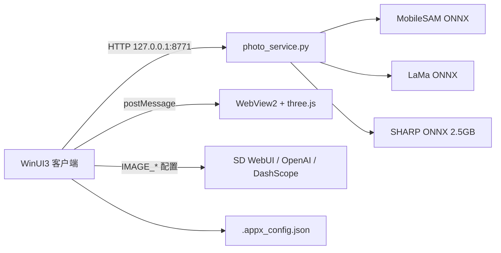

## 产品概述

intelligentSTUDIO 的独立照片编辑器，WinUI 3 桌面应用，对标 Apple 照片的智能编辑。左侧五项工具，中间画布，右侧参数面板，标题栏右上角导出。未导入图片时整窗呈现模糊质感，居中提供「打开照片」并支持拖拽导入。

## 核心功能

- 裁剪：标准比例（原始、1:1、4:3、3:4、16:9、9:16、3:2、2:3）、自由拉伸、90° 与微调旋转、镜像、重置。
- 滤镜：亮度、对比度、饱和度、色温、锐化、暗角滑块，配合预设风格，实时预览。
- 消除：点选或涂抹后由分割模型把笔迹扩张为画面中的单个元素；确认后掩码边缘再外扩一小圈，与原图一并交给生成模型补全。笔迹处白高光与淡彩虹慢流动，分割完成后转为该元素轮廓的高光流动彩虹，生成结束消失。
- 扩展：进入后原图缩小，四周延伸出模糊的大片区域，用户决定扩展范围；确认后原图与遮罩交模型补全，图片下方显示无百分比的蓝色进度与提示文字。
- 重构：切换即启动单图 3D 重建，期间显示模糊与彩虹扰动；完成后在画布内嵌 3D 场景，拖拽改变视角，确认后补全缺失区域，进度样式与扩展一致。
- 消除、扩展、重构生成期间禁止切换选项卡。
- 五个环节结果按顺序缓存，切换选项卡保留上游修改；导出保存当前结果。

## 视觉与文案

深色 Mica 底、玻璃浮层、极克制的彩虹光效；蓝色只用于进度与主操作。全部文案中文、动宾短句、动词化按钮，不出现百分比、感叹号与旧名称。

## 技术栈

- 客户端：WinUI 3（Windows App SDK 1.6）+ .NET 8，C# / XAML，沿用仓库三个应用一致的 csproj 属性与产物路径。
- 图像处理：`Windows.Graphics.Imaging`（WIC）解码编码 + `SoftwareBitmap` + CPU 像素管线（`Span` + `Parallel.For`），不引入 Win2D。
- 3D：`Microsoft.UI.Xaml.Controls.WebView2` 承载本地 three.js 场景，通过 `SetVirtualHostNameToFolderMapping` 挂载虚拟主机。
- 推理服务：Python 3 + FastAPI/uvicorn + ONNX Runtime（DirectML 优先、CPU 回退），独立虚拟环境避免污染现有后端。
- 生图：只读取 `.appx_config.json` 的 `IMAGE_API_BASE/KEY/MODEL/PROVIDER`，C# 侧实现 SD WebUI `img2img+mask`、OpenAI `images/edits`、DashScope 适配，不新增配置键。

## 已核实事实与约束

- 工程约定（`playground-app/ImagePlayground.csproj`）：`net8.0-windows10.0.19041.0`、`WindowsPackageType=None`、`WindowsAppSDKSelfContained=true`、`Microsoft.WindowsAppSDK 1.6.250205002`、图标 `..\Logo\照片智能编辑器.ico`。
- 窗口外观（`playground-app/MainWindow.xaml(.cs)`）：Mica 回退、`ExtendsContentIntoTitleBar` + `SetTitleBar`、`AppWindow.TitleBar.RightInset` 留位、DWM 圆角 33、两点 RadialGradient 氛围光。
- 设计令牌（`playground-app/App.xaml`）：`RainbowBrush` 五色、`AppAccentBlue #0A84FF`、`AppTextPrimary/Secondary/Tertiary`、`PillButtonStyle` / `GlassPillButtonStyle` / `GlyphIconButtonStyle` / `SidebarNavItemStyle`，全部照抄改名空间。
- 彩虹光边（`Controls/RainbowInput.xaml.cs`）：16 层 `ShapeVisual` + `CompositionRoundedRectangleGeometry`，`RainbowPalette` 25 秒环行；WinUI 3 无 conic-gradient，只能多层近似，禁止改用单色描边。
- 进度语言（`Controls/CanvasOrb.xaml`）：两层 4px `Border` + `ScaleTransform`，`Storyboard` 380ms `CubicEase`；不使用 `ProgressBar`，不显示百分比。
- 工具类：`AppLog`、`SettingsStore`（向上查找含 `package.json` 与 `backend/` 的仓库根）、`SaveService`（`InitializeWithWindow.Initialize`）、`SettingsLauncher` 各复制一份到新工程。
- 现有应用生成期间并未禁用侧栏，本需求必须自行加锁（禁用五个导航项并拦截切换请求）。
- C# 侧从未使用 WebView2 与 ONNX Runtime，属新增能力；主环境 `onnxruntime-directml` 与 `onnxruntime-genai` 互斥，故推理服务使用独立 venv，不动 `backend/requirements.txt`。
- 现有后端端口 8769/8770/8766-8768，新服务固定 8771。

## 实现方案

### 编辑管线

`EditSession` 持有 `Original → CropResult → FilterResult → EraseResult → ExpandResult → ReframeResult`。每次确认某环节即写入其结果并清空下游，切换选项卡只读缓存不再重算；画布始终显示下游最新结果。像素数据用 `SoftwareBitmap`（BGRA8）常驻内存，预览按长边 1600px 降采样，确认与导出才走全分辨率。

### 消除的分割闭环

`POST /api/segment`：一次编码器生成图像 embedding（按 imageId 缓存），随后的点选/涂抹仅跑轻量解码器（毫秒级），支持迭代精修。前端把涂抹点集与粗掩码一起提交，后端取最大连通分量、按面积过滤误触、填洞，返回掩码 PNG、包围盒与外扩像素数。C# 按外扩值膨胀掩码（约为长边 0.25%，下限 4px）后再交补全。

### 补全的双通道

默认「自动」：探测到 SD WebUI 且返回的模型支持 inpaint 时优先云端（语义补全更自然），否则本地 LaMa。右侧面板显示「引擎：自动 / 本地 / 云端」，仅当云端可用时出现后两项。消除与扩展共用同一 `InpaintClient`，扩展只是把 mask 换成画布新增区域。不实现 KIE，统一走 STUDIO 设置。

### 重构的移植边界

Python 端跑 SHARP，输出高斯参数（位置、尺度、旋转、不透明度、球谐颜色）与相机内参，转成二进制 splat 与 JSON 元数据；WebView2 页面只保留「加载 + 轨道控制 + 捕获」三件事：three.js 场景、`OrbitControls` 式拖拽、`renderer` 输出当前视角 PNG 与相机矩阵回传。Photo-Reframing 的选项卡、液态玻璃、导入流程全部丢弃；其 `edge-fill-pass` 的「相机投影求空白区」思路用于在 C# 侧生成遮罩。

### 性能与可靠性

- 像素处理：按行分块 `Parallel.For`，只处理 RGBA 四通道，预览阶段不做全图重采样。
- 笔迹：屏幕坐标系累积点，仅在 `PointerMoved` 节流（16ms）重绘 `Polyline`；不逐点创建元素。
- 后端：模型懒加载且常驻，`/api/jobs/{id}` 轮询 300ms，只回阶段字符串与粗进度，供界面做无百分比的线性推进。
- 失败路径：超时、HTTP 错误、显存不足分别落到中文 `InfoBar`，可重试；任何失败都不得让画布停留在半成品。
- 日志：复用 `AppLog` 风格，写 `%LOCALAPPDATA%\IntelligentStudio\照片编辑器\log.txt`，256KB 轮转，不记录 API Key 与图像内容。

## 架构设计



C# 侧为唯一编排者：图像编解码、遮罩生成、补全调用、进度与锁定都在客户端；Python 只做本地推理，无状态（除 embedding 与 job 缓存）。

## 目录结构

```
photo-app/
├── PhotoEditor.csproj          # [NEW] 照抄 ImagePlayground.csproj；图标 照片智能编辑器.ico；含 viewer 资源 Content
├── app.manifest                # [NEW] 复制现有清单
├── App.xaml / App.xaml.cs      # [NEW] 复制设计令牌与样式，注册 MainWindow、处理命令行图片路径
├── MainWindow.xaml(.cs)        # [NEW] Mica、自绘标题栏、导出按钮、三栏布局、拖拽导入、全局生成锁
├── Views/
│   ├── CropPage.xaml(.cs)      # [NEW] 比例预设、自由拉伸把手、旋转、镜像
│   ├── FilterPage.xaml(.cs)    # [NEW] 六个滑块 + 预设卡片 + 实时预览
│   ├── ErasePage.xaml(.cs)     # [NEW] 画笔/点选、SAM 预演、确认与进度
│   ├── ExpandPage.xaml(.cs)    # [NEW] 边界把手、扩展量、确认与进度
│   └── ReframePage.xaml(.cs)   # [NEW] WebView2 宿主、重建进度、视角确认
├── Controls/
│   ├── ImageCanvas.xaml(.cs)   # [NEW] 缩放平移、坐标映射、遮罩叠加
│   ├── BrushOverlay.xaml(.cs)  # [NEW] 笔迹、白高光与彩虹流动、元素轮廓光环
│   ├── RainbowProgressBar.xaml(.cs) # [NEW] 蓝色无百分比进度与阶段文字
│   └── EmptyState.xaml(.cs)    # [NEW] 模糊背景、打开照片、拖拽提示
├── Services/
│   ├── SettingsStore.cs        # [NEW] 复制，只读 IMAGE_* 四项
│   ├── AppLog.cs               # [NEW] 复制，改目录名为「照片编辑器」
│   ├── SaveService.cs          # [NEW] 复制，导出 PNG/JPEG
│   ├── SettingsLauncher.cs     # [NEW] 复制，缺配置时打开 STUDIO 设置
│   ├── RainbowPalette.cs       # [NEW] 复制
│   ├── ImageCodec.cs           # [NEW] WIC 解码/编码、SoftwareBitmap 与字节互转
│   ├── ImageProcessor.cs       # [NEW] 裁剪、旋转、拉伸、滤镜核、掩码膨胀
│   ├── EditSession.cs          # [NEW] 六级结果缓存与失效规则
│   ├── PhotoServiceClient.cs   # [NEW] 纯本地推理服务客户端与 job 轮询
│   ├── GenerationClient.cs     # [NEW] 三协议探测与 inpaint 分派
│   ├── ShellIntegration.cs     # [NEW] HKCU 右键菜单注册/撤销、命令行传参
│   └── ReframeBridge.cs        # [NEW] WebView2 postMessage 协议与捕获回传
├── Assets/Viewer/              # [NEW] index.html、viewer.js、style.css、viewer.bundle.js
└── viewer-src/                 # [NEW] three.js 场景源码与 esbuild 构建脚本
backend/
├── photo_service.py            # [NEW] FastAPI：segment / inpaint / reframe / jobs
└── photo/                      # [NEW] sam_engine.py、inpaint_engine.py、sharp_engine.py、jobs.py、ep.py
models/photo/                   # [NEW] MobileSAM、LaMa、sharp_web_predictor.onnx(+data)
scripts/fetch-photo-models.py   # [NEW] 校验与下载模型，构建阶段一次性执行
run-photo-editor.bat            # [NEW] 照 run-playground-app.bat，首次拉起 photo_service（独立 venv）
```

## 关键实现说明

- 服务契约：`POST /api/segment`（image、points、scribble）→ maskPNG/bbox/ringPx；`POST /api/inpaint`（image、mask、feather）→ png；`POST /api/reframe/prepare` → jobId；`GET /api/jobs/{id}` → state/stage/progress/result；`POST /api/jobs/{id}/cancel`。图像一律 base64 PNG，避免临时文件争用。
- 模型校验：记录 sha256 与期望字节数到 `models/photo/manifest.json`，缺失或校验失败时界面给中文提示并指向 `scripts/fetch-photo-models.py`，运行期绝不联网。
- WebView2：虚拟主机 `photo.local` 指向 `Assets/Viewer`，禁用右键菜单与开发者工具，`WebMessageReceived` 只接受白名单消息类型。
- 右键菜单：仅写 `HKCU\Software\Classes\SystemFileAssociations\.png/.jpg/.jpeg\.webp\shell\IntelligentStudioPhotoEditor`，命令 `"<exe>" "%1"`；开关放在应用内，默认关闭，撤销时递归删除。
- 兼容性：Python 端按 `DmlExecutionProvider → CUDAExecutionProvider → CPUExecutionProvider` 顺序尝试并记录实际 EP；SHARP 在 CPU 上预计数十秒级，进度用阶段文字而非百分比承担等待感。

## 设计风格

深色 Fluent 玻璃：Mica 底、半透明浮层、极克制的彩虹。层次参照 Apple 照片——画布最亮、参数面板后退、导航最轻。排版取 apple-design 的呼吸感与 emil-design-eng 的「反馈克制、动效有据」，文案按 apple-hig-writing 的动词化与短句规则。

## 页面规划（六屏）

1. 空状态：整窗模糊底、居中玻璃卡「打开照片」、副文案「或把照片拖到这里」。拖入时描边高亮并轻微放大。
2. 裁剪：左五项导航；画布上九宫格与四角把手；右面板比例九宫格、旋转滑杆、镜像与重置；底部确认。
3. 滤镜：画布实时预览；右面板六条滑块、预设缩略带横向滚动、重置；确认后面板短暂高亮。
4. 消除：画布支持画笔与点选，笔迹白高光与淡彩虹慢流；右面板笔刷大小、撤销、清除、确认；生成时画布边缘出现柔和光边，导航置灰。
5. 扩展：原图居中缩小，四周模糊延展区带四边把手；右面板扩展量与引擎选择；确认后图片下缘浮出蓝色进度条与阶段文字。
6. 重构：画布切换为嵌入的 3D 场景，底部提示「拖动改变视角」；右面板确认与重置视角；重建期显示模糊与彩虹扰动，生成期显示同款进度条。

## 交互与动效

导航切换 180ms 淡入加 8px 上移；面板切换横向 12px 位移；把手拖拽跟手无缓动；确认后的结果以 240ms 交叉淡入替换画布；所有禁用态用 160ms 透明度过渡，不出现硬切。彩虹只出现在光边、笔迹轮廓与选中态短条，正文与按钮不用彩色渐变。

## Agent Extensions

### Skill

- **apple-design**：约束三栏空间分层、玻璃材质、手势与弹簧曲线的取舍；产出主窗口与五个选项卡的间距、层级、动效参数。
- **emil-design-eng**：约束动效与交互细节（按下反馈、禁用态过渡、进度呈现），确保没有廉价硬切，也不过度装饰。
- **apple-hig-writing**：产出全部界面文案（按钮、空状态、阶段提示、错误信息），统一动词化、短句与中文标点。
- **rainbow-loading-pill**：提供彩虹流光与沿边光边的参数化构造思路，改写为 WinUI 3 的 Composition 多层实现，用于笔迹光效与元素轮廓。
- **animate**：给出动效决策顺序（是否动画、属性、曲线、时长、打断与退出），用于确认画布替换、选项卡切换与进度条推进的具体参数。

### SubAgent

- **code-explorer**：在实现前定位 Photo-Reframing 的 `edge-fill-pass.ts`、`image-generate-fx.ts`、`scene.ts` 与 `inference.ts` 关键逻辑，以及仓库内 `RainbowInput`、`CanvasOrb`、`SettingsStore`、`SaveService` 的确切可复用片段，避免路径与签名臆测。