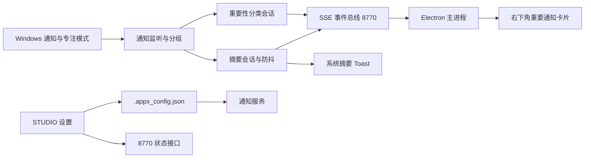

## 产品概述

intelligentSTUDIO 的通知智能与智能勿扰：由本机模型判断系统通知的重要性，在系统专注模式开启时只放行重要通知；同时按应用与会话归纳通知，生成摘要并写入系统通知中心。两个功能各有独立开关，均位于「STUDIO 设置」。

## 核心功能

- 通知监听：读取系统通知，按「应用 + 会话 / 发送者」分组；来源与内容相同且 5 秒内重复的通知只计数，不重复参与归纳。
- 智能勿扰：仅在设置开关开启且系统专注模式开启时生效；重要通知以右下角自绘卡片展示，非重要通知不弹窗，只进入归纳缓冲。
- 重要通知卡片：布局、进场退场动画与提示音模仿 Windows 通知，卡片背后有多色彩虹光晕，标题区标注「重要通知」；支持多条堆叠、悬停保持、点击关闭。
- 通知归纳：开关独立于勿扰且始终生效；60 秒窗口内同一会话累计达到阈值（默认 3 条）生成首条摘要；之后静默 30 秒再重生成，输入为旧摘要加增量通知，成功后撤销旧摘要并发出新摘要。
- 模型与降级：重要性与摘要全部由本机模型完成，模型缺失时明确提示不可用，不使用关键词或规则替代判断；推理超时或失败时本条静默，不阻塞后续通知。
- 状态可见：设置页显示监听状态、系统专注模式当前状态、两个模型是否就绪、归纳阈值，并提供重新检查入口。
- 生命周期：分类与摘要会话均懒加载，空闲后卸载；智能勿扰跟随系统专注模式，关闭即卸载分类会话。

## 技术栈

- 通知服务：Python 3.12 + FastAPI/uvicorn（新增端口 8770），onnxruntime 与 onnxruntime-genai 做本地推理，tokenizers 做二分类分词，winsdk 1.0.0b10 访问 Windows 通知与专注模式接口，pywin32 注册 AUMID 快捷方式。
- 桌面层：Electron 31 主进程托管子服务与置顶窗口，React 18 + framer-motion 实现重要通知卡片，Vite 多页构建。
- 设置层：WinUI3（DonySettings）现有页面改造，沿用 DonyCardStyle、InfoBarHelper、SettingsStore。
- 配置：统一读写 `.appx_config.json`，新增键沿用现有 `SMART_DND_ENABLED`、`NOTIFY_SUMMARY_ENABLED`、`NOTIFY_SUMMARY_THRESHOLD`，不破坏已保存设置。

## 实现方案

1. 单进程通知服务：新增 `backend/notification_service.py` 入口与 `backend/notification/` 包，Electron 参照 `startAgentServer()` 启停：端口被占用则先接管旧实例，异常退出按 1 秒递增退避重启，最多 5 次，`will-quit` 时统一结束。
2. 配置热读取：仿照 `backend/agent/store.py` 的 mtime 缓存，每 2 秒检查一次 `.appx_config.json`；设置页保存后无需额外转发即可生效，设置页只负责写文件与读取状态。
3. 通知监听：`UserNotificationListener.current`，已实测访问状态为 Allowed。启动时先取一次现有通知 ID 作为基线并清空本应用历史摘要，避免历史通知被当成新通知。实时用 `add_notification_changed` 事件，另加 3 秒兜底轮询补偿事件丢失。`get_notifications_async` 返回 `IAsyncOperation`，必须轮询 `status` 后取 `get_results()`，不能直接 `asyncio.run`。事件回调线程通过 `loop.call_soon_threadsafe` 投递到事件循环，回调内只做文本提取，推理全部异步。
4. 专注模式：`WNF_SHEL_QUIETMODE_STATE_CHANGE`（0x0D83063E）经 `ntdll.NtQueryWnfStateData` 读取，覆盖 Windows 11 勿扰；同时读取 `FocusSessionManager.get_default().is_focus_active` 并订阅变更事件，覆盖专注会话。两路取或，任一路可用即有效；均不可用则状态为 unknown 并按关闭处理，绝不改写系统设置。5 秒轮询兜底，成本可忽略。
5. 重要性分类：模型目录固定 `models/notification-classifier/`，懒加载，单线程执行器串行推理，单条 1.5 秒超时；超时或异常本条静默并计入摘要缓冲，不使用规则打分。专注模式关闭立即卸载，专注开启期间 90 秒无通知卸载。文本输入为「应用名 + 标题 + 正文」，标签由 `config.json` 的 `labels` 决定，缺省按 `["important","normal"]`。
6. 摘要生成：模型目录固定 `models/qwen2.5-0.5b-instruct-int4/`，onnxruntime-genai CPU，输出限制 16–32 tokens，单次 7 秒超时。首次触发后进入 30 秒防抖；有新通知只更新计数并重置计时，等待期间暂停空闲卸载；静默结束用「旧摘要 + 增量」重生成，成功后撤销旧摘要再发新摘要，失败保留旧摘要与增量。会话 30 秒空闲卸载，连续占用上限 120 秒。
7. 摘要通知：AUMID 固定为 `com.dony.intelligentstudio`，启动时用 pywin32 的 IShellLink 与 IPropertyStore 确保开始菜单存在带该 AUMID 的快捷方式，再用 `ToastNotificationManager.create_toast_notifier` 发送；替换时先 `UserNotificationListener.remove_notification(旧 id)`，旧摘要已被用户清除时忽略错误。发送失败时记录日志并通过 SSE 让桌面层以自绘卡片兜底，不静默丢失。
8. 桌面联动：通知服务提供 `GET /api/events`（SSE）推送重要通知与摘要兜底事件，Electron 主进程用内置 http 模块订阅，断线 1 秒重连；重要通知进入最多 3 条的队列，单窗口动态高度，贴主屏工作区右下角，`showInactive` 不抢焦点，8 秒自动消失且悬停暂停。
9. 性能与稳定：所有推理走 `asyncio.to_thread`，监听回调不做阻塞操作；摘要防抖避免高频推理；配置检查为 2 秒一次 stat；模型加载失败只影响对应功能，服务本身不退出。

## 架构设计



## 实现要点

- 现有 overlay、托盘、语音与 Agent 逻辑一律不动；托盘菜单保持三项，不新增入口。
- 通知服务崩溃不得影响主界面：spawn 失败只记录日志，功能降级为不可用，设置页如实显示。
- 重要性判断严禁退化为关键词或白名单评分；模型缺失即功能不可用。
- 日志统一 `[notify]` 前缀，只打印应用名、分组键与耗时，不打印通知正文全文，避免隐私泄漏与日志膨胀。
- 摘要与重要通知的去重键使用「应用 AUMID + 归一化会话标识」，同源同文 5 秒内只计数。

## 目录结构

```
backend/
├── notification_service.py          # [NEW] 服务入口，uvicorn 监听 127.0.0.1:8770
└── notification/
    ├── __init__.py                 # [NEW] 包声明
    ├── config.py                   # [NEW] 读取 .appx_config.json（mtime 热读）与常量：阈值、窗口、超时、模型目录
    ├── focus.py                    # [NEW] WNF 读取 + FocusSessionManager 事件，输出 on/off/unknown 与来源
    ├── listener.py                  # [NEW] 通知监听、启动基线、事件投递、3 秒兜底轮询、文本提取
    ├── grouping.py                 # [NEW] 分组键、60 秒窗口、5 秒去重、30 秒防抖状态机、增量缓冲
    ├── classifier.py               # [NEW] ONNX 二分类会话：懒加载、串行推理、1.5 秒超时、90 秒卸载
    ├── summarizer.py               # [NEW] GenAI 会话：16–32 tokens、7 秒超时、30 秒空闲与 120 秒上限卸载
    ├── toast.py                    # [NEW] AUMID 快捷方式注册、摘要 Toast 发送与撤销、历史清理、失败上报
    ├── events.py                   # [NEW] SSE 广播器与 /api/status 数据结构
    ├── service.py                  # [NEW] FastAPI 应用：/api/status、/api/events、/api/reload、事件编排
    └── _selftest.py                # [NEW] 分组、去重、防抖、撤销与降级路径的离线自测
models/
├── notification-classifier/README.md      # [NEW] 模型文件约定：model.onnx、tokenizer.json、config.json（labels、max_length）
└── qwen2.5-0.5b-instruct-int4/README.md   # [NEW] GenAI 目录约定：genai_config.json、model.onnx、tokenizer.json
electron/
├── main.js                          # [MODIFY] 启停通知服务、SSE 订阅、重要通知窗口队列与定位、退出清理
└── preload.js                       # [MODIFY] 暴露 onImportantNotification、dismissImportantNotification
src/
├── notify/main.tsx                  # [NEW] 通知窗口渲染入口
├── notify/NotifyApp.tsx             # [NEW] 卡片列表、堆叠、悬停暂停、点击关闭
├── notify/notify.css                # [NEW] 毛玻璃卡片、彩虹光晕、入场退场动效、深浅色适配
└── types.ts                         # [MODIFY] ElectronAPI 增加通知相关方法
notify.html                          # [NEW] 通知窗口页面
vite.config.ts                       # [MODIFY] rollup 新增 notify 入口
settings-app/
├── Views/NotificationsPage.xaml     # [MODIFY] 状态卡片、模型就绪、专注模式、阈值说明、移除未接入提示
├── Views/NotificationsPage.xaml.cs  # [MODIFY] 读取 8770 状态、重新检查、保存后刷新
├── Views/HomePage.xaml              # [MODIFY] 两个开关文案与实际行为一致
├── Views/HomePage.xaml.cs           # [MODIFY] 保存后调用 NotifyBackendAsync
└── Services/SettingsStore.cs        # [MODIFY] 增加通知服务状态查询辅助
start.bat / start.ps1                # [MODIFY] 端口列表加入 8770，补说明
backend/requirements.txt             # [MODIFY] 增加 onnxruntime、onnxruntime-genai、tokenizers
```

## 关键结构

```text
SSE 事件（/api/events）
important  { type, app, title, body, at, group, notification_id }
summary    { type, app, group, title, body, count, toast_ok }
status     { type, listener, focus, focus_source, classifier, summarizer, threshold }
```

## 设计风格

沿用 intelligentSTUDIO 既有的 Fluent 语言与 Apple Intelligence 彩虹点缀：毛玻璃表面、16px 圆角、细描边、克制的彩色光晕。所有出现、消失与尺寸变化均有弹性过渡，不出现瞬变。

## 重要通知卡片（右下角）

- 定位：主屏工作区右下角，距边 24px；单条宽 360，最多堆叠 3 条，新卡片在底部，旧卡片上移。
- 结构：顶部一行左侧为线条铃铛图标（或通知自带应用图标），随后是渐变描边的「重要通知」胶囊；右侧为应用名与时间。正文 13px，最多两行省略；底部 1px 分隔线与来源说明。
- 光效：卡片外侧 8px 处铺 conic-gradient（#0A84FF、#BF5AF2、#FF375F、#FF9F0A）并 blur 26px，透明度 0.45，24 秒缓慢旋转；重要通知到达时 4 秒呼吸一次（0.38 至 0.6）。
- 动效：入场自右下方向上 12px、缩放 0.96 至 1，spring（stiffness 420，damping 32），末尾减速；退场 160ms 淡出并下移 6px；悬停抬升 1px、阴影加深、光晕亮度提升。
- 声音：使用系统通知音，鼠标悬停期间暂停自动消失计时，点击卡片立即收起。

## 设置页「通知智能和勿扰」

- 沿用 DonyTitleStyle 与 DonyCardStyle，将现有两组开关整理为两张卡片：功能开关、归纳参数。
- 新增状态区：监听状态、系统专注模式、分类模型、摘要模型四行，每行由 6px 圆点（正常绿、异常红、未知灰）与 13px 文本组成；模型缺失时用 Warning InfoBar 显示预期目录。
- 文案与实际行为一致：摘要始终归纳；智能勿扰仅在开关与系统专注模式同时开启时生效；不再显示「尚未接入后端」。