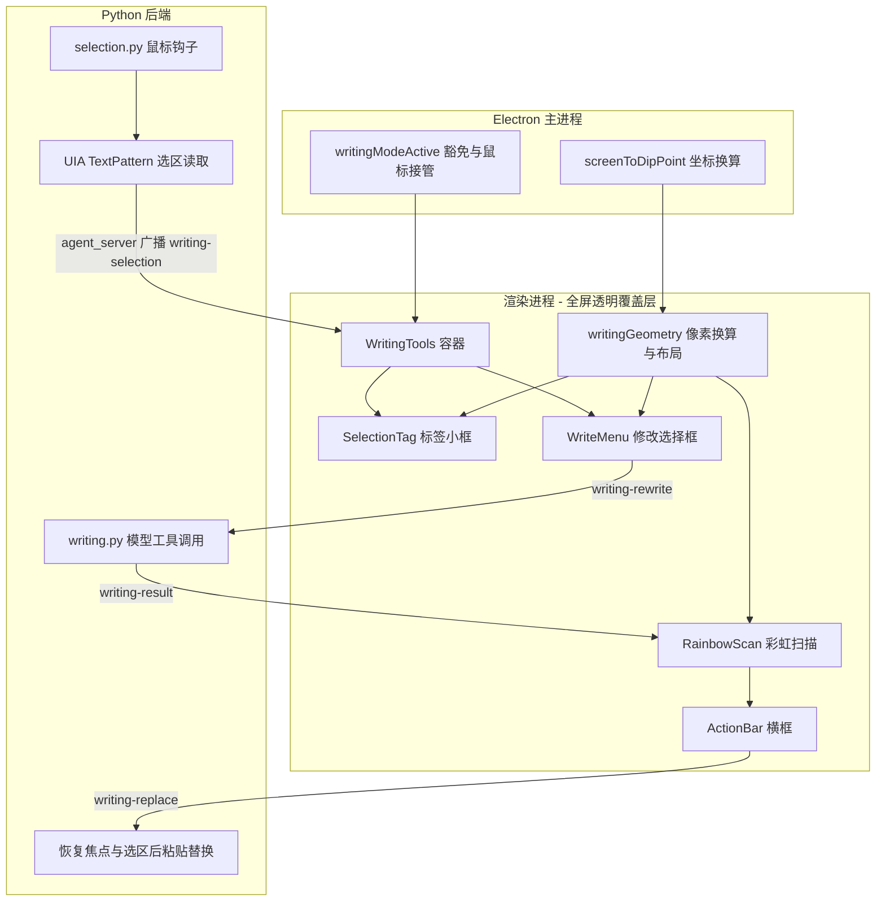

## Product Overview

在 intelligentSTUDIO 中新增「写作工具」（对标苹果智能 Writing Tools）。用户在任意可输入文本的位置选中文字后，通过选区旁的小标签进入改写菜单，选择改写动作后由模型返回改写文本并就地替换选区。全程覆盖层不抢焦点、非元素区域鼠标穿透、不产生新的任务栏图标。

## Core Features

- **触发**：选中文字满足「选区在当前窗口内」「不是文件名等小文本框」「选中字数大于 20」时，在选区开头的文本逻辑起点（与拖拽方向无关）淡入一个标签小框；框内只放一个完整线描六边形图标，不放文字；鼠标靠近时才显示。
- **修改选择框**：点击小框后从该位置向左扩大弹出；左侧屏幕空间不足时改为向右。内容完整复刻参考图二：顶部彩虹流光输入框（占位文字「描述修改」）、两列大按钮「校对」「改写」、分组「友好」「正式」「简洁」、分组「摘要」「要点」「列表」「表格」、末项「创作…」。卡片随系统深浅色变化，主体卡的透明度、壁纸模糊与边缘灰色细线对齐 Dony 对话卡片，且不修改 Dony 任何文件。
- **原路返回**：用户确认某项操作后，修改选择框以反向动画收回消失。
- **彩虹扫描与横框**：确认后选区出现半透明彩虹扫描动画（蒙在文字之上），同时选区上方短距离飞入横框。横框含左端「复原」与撤回图标、中部当前操作名、「按住预览原文」按钮、右端蓝色「保留」按钮。
- **替换**：选中文字发给模型，模型通过工具调用返回改写文本；结果返回后彩虹扫描结束，选区文字被直接替换。替换前按住预览按钮可浮层查看原文，松开回到结果。
- **保留与恢复**：横框内选择保留更改或恢复原文。
- **过程反馈**：生成中提供取消入口；所有出现、隐藏、扩缩均带过渡动画，飞入一律为「快速飞入 + 末尾减速缓冲」。

## Tech Stack

- 渲染层：React 18 + TypeScript + Vite（沿用项目现状，自研 CSS，不引入组件库与 UI 依赖）
- 主进程：Electron 31（`electron/main.js` + `electron/preload.js`，contextIsolation 已开启）
- 平台能力：Python 3 + `uiautomation 2.0.29`（UIA `TextPattern`）+ `pywin32 312`（低层鼠标钩子、剪贴板、窗口焦点）+ `comtypes`，均已在项目 `.venv` 中，无需新增依赖
- 通信：复用既有 WebSocket 通道 `ws://127.0.0.1:8767`（`backend/agent/agent_server.py` 与渲染层 `src/utils/ws.ts` 的 `agentSocket`）
- 模型：复用 `backend/agent/config.py` 的 `API_KEY` / `API_BASE` / `MODEL` 与 `llm.py` 的流式请求范式，通过 `tools` + `tool_choice` 强制模型调用工具返回改写结果

## Implementation Approach

以「UIA 读取选区几何 + 全屏覆盖层绝对定位」为核心策略：Python 侧监听全局左键抬起，读取 UIA 选中范围得到文本、逐行矩形数组与逻辑起点锚点，经既有 WS 广播给渲染层；渲染层在全屏透明覆盖层内以绝对定位绘制标签小框、修改选择框、彩虹扫描与横框，不移动窗口、不新建窗口，因而天然满足「鼠标穿透」与「不产生任务栏图标」。改写请求由 WS 转发到后端，模型以工具调用形式返回改写文本，替换阶段把焦点还给目标窗口并重新选中原范围后以剪贴板粘贴完成写入。

关键决策与理由：

1. **复用 8767 通道而非新建服务**。项目已有 `agent_server`（WS 广播能力 `server.broadcast`）与渲染层 `agentSocket`（自动重连 + 消息分发），新增消息类型即可完成双向下发，避免新增端口、进程与客户端依赖。
2. **选区几何走 UIA `TextPattern`，起点与区域一次取全**。`TextRange.GetBoundingRectangles()` 返回逐行矩形（屏幕物理像素），既覆盖用户要求的「区域用 UIA 矩形数组」，也天然给出逻辑起点锚点：把克隆范围的 End 端点移到 Start 端点后取首段矩形即可，与拖拽方向无关。
3. **不移动覆盖层窗口**。全屏覆盖层原点即主屏原点，窗口内坐标等于屏幕 DIP 坐标，元素定位只需一次物理像素到 DIP 的换算。相比「移动小窗」方案，省掉窗口尺寸抖动、任务栏归属重建与鼠标接管反复切换三类问题。
4. **替换用剪贴板粘贴而非逐字模拟**。项目已有 `type_text` 的同款做法（`win32clipboard` 写剪贴板 + `ctrl+v`），可规避中文输入法状态、键盘布局与逐字输入的时序问题，并保留目标程序的撤销栈（Ctrl+Z 可回退）。
5. **不修改 Dony 现有文件的行为**。材质层走「新增组件复用 `acrylic.css` 变量」的方式，六边形新增线描版本组件而非改动 `Hexagon.tsx`；主进程改动一律以「新增 writing 标记 + 分支豁免」的形式插入，不触碰视觉智能与闹钟链路。

性能与可靠性：UIA 调用单次约数十毫秒且必须在非 UI 线程完成 COM 初始化（复用 `_uia_run`），因此仅在左键抬起后延迟查询一次并带 2 次重试，绝不在鼠标移动回调内查询；钩子回调只做时间戳与位置记录。事件带自增 `seq`，渲染层丢弃过期消息，避免快速连续选词时的错位。

## Implementation Notes

- **三处必须豁免 writing 模式**，否则界面会被既有逻辑自行收掉：`ipcMain.on('overlay-state')` 中 idle 延迟 1500ms 自动收窗、`isAlreadyAwake()` 的「界面无内容按未唤醒处理」、覆盖层 `blur` 时下发的 `blur-dismiss`。参照现有 `visualModeActive` 的豁免写法插入 `writingModeActive` 判断。
- **穿透与接管的既有约定不可破坏**：穿透用 `setIgnoreMouseEvents(true, { forward: true })`，恢复必须只传 `false`。写作元素只在自己被指针覆盖时才接管鼠标。
- **焦点纪律**：显示标签、卡片、横框期间覆盖层保持不可聚焦（`setOverlayFocusable(false)`），以免破坏目标程序的选区；仅在用户点击「描述修改」或「创作」输入框时恢复可聚焦并 `focus()`，回车后立即把焦点交还目标窗口。
- **替换前必须用 UIA `Select()` 恢复原选区**，因为用户输入自定义要求期间可能误点，导致粘贴位置漂移；恢复失败时不盲目粘贴，应回报失败并保留原文。
- **物理像素到 DIP 一律用 `screen.screenToDipPoint()`**，不要手写除以缩放比，多屏混合 DPI 会错。
- **不新增原生依赖**：不引入 `uiohook-napi` 等 Node 原生模块，鼠标钩子放在 Python 侧（`pywin32` 已在依赖内）。
- **日志**：沿用 `renderer-log` 与后端 `print`，仅在关键状态迁移（触发、动作开始、替换成功/失败）各留一行，避免刷屏与泄露选中文本内容。

## Architecture Design



## Directory Structure

```
project-root/
├── backend/
│   └── agent/
│       ├── selection.py           # [NEW] 选区监听：全局低层鼠标钩子（独立线程 + 消息循环）+ 左键抬起后延迟查询 UIA。复用 uia_screen._uia_run 完成 COM 初始化，用 GetFocusedControl().GetTextPattern().GetSelection() 取文本与 GetBoundingRectangles() 取逐行矩形；克隆范围把 End 端点移到 Start 得到逻辑起点锚点；记录前台窗口 hwnd 与控件类名/外框用于「非小文本框」判定；按最小字数、控件高度、矩形有效性过滤后由 agent_server 广播 writing-selection（带 seq）。
│       ├── writing.py             # [NEW] 写作动作服务：按 校对/改写/友好/正式/简洁/摘要/要点/列表/表格/自定义 组装指令，调用 OpenAI 兼容接口并配 tools + tool_choice 强制模型调用 apply_edit 工具取回改写文本；提供替换执行：SetForegroundWindow 交还焦点、UIA Select() 恢复原选区、剪贴板写入后 ctrl+v 粘贴，失败时回报而不盲目粘贴；提供取消入口。
│       ├── agent_server.py        # [MODIFY] Session.handle 新增 writing-rewrite / writing-replace / writing-cancel 消息分支与结果回发；启动时按配置挂载 SelectionWatcher 并把选区事件广播给 overlay 会话。不改动既有 Dony 对话分支。
│       └── config.py              # [MODIFY] 新增写作工具常量：最小选中字数、控件高度阈值、改写温度、是否启用监听，均带环境变量覆盖，沿用现有 _cfg/os.getenv 两级读取写法。
├── electron/
│   ├── main.js                    # [MODIFY] 新增 writingModeActive 标记与三处豁免（idle 自动收窗、isAlreadyAwake、blur-dismiss）；新增写作工具期间的鼠标接管与焦点让位控制；把物理像素换算为 DIP 的窗口坐标下发（复用 screen.screenToDipPoint 与既有 IPC 范式）；提供光标屏幕坐标查询供「鼠标靠近才显示」判定。不新建窗口，任务栏图标沿用既有 applyToolWindowStyle。
│   └── preload.js                 # [MODIFY] 暴露新增 IPC：写作模式进入/退出、光标坐标查询、鼠标接管与焦点让位开关；沿用现有 onXxx/setXxx 命名风格。
├── src/
│   ├── App.tsx                    # [MODIFY] 新增 writingMode 状态与模式互斥（与视觉智能、语音互斥并在 reset 中清理）；通过 agentSocket.on 订阅 writing-selection / writing-result / writing-replaced 等消息；渲染 WritingTools。
│   ├── types.ts                   # [MODIFY] 新增写作工具类型：选区事件载荷、动作枚举、改写结果、electronAPI 扩展声明。
│   └── components/overlay/writing/
│       ├── WritingTools.tsx       # [NEW] 流程容器与状态机：待触发 → 标签显示 → 菜单展开 → 改写中（彩虹扫描 + 横框）→ 结果（保留/复原/按住预览）→ 退出；统一管理元素显隐、动画编排与 IPC/WS 调用。
│       ├── WritingTools.css       # [NEW] 全部样式，明暗两套；主体卡复用 acrylic 材质变量与 --dony-acrylic-edge 细线、--dony-acrylic-shadow 投影，不引入 backdrop-filter。
│       ├── SelectionTag.tsx       # [NEW] 图一：深色圆角玻璃标签小框，内部仅线描六边形；淡入淡出；仅当指针靠近锚点矩形时显示。
│       ├── WriteMenu.tsx          # [NEW] 图二：修改选择框。顶部为彩虹流光输入框（占位「描述修改」），下方两列大按钮与四组列表项，分组间细分隔线；不启用沿边框加载光边。
│       ├── ActionBar.tsx          # [NEW] 图三：横框。左端「复原」与撤回图标、中部操作名、按住预览原文按钮、右端蓝色「保留」；飞入为快速飞入 + 末尾减速缓冲。
│       ├── RainbowScan.tsx        # [NEW] 选区彩虹扫描：按逐行矩形渲染半透明彩虹层并使用掩码只覆盖选区，叠加扫过与流动动画；参数集中在一处便于按新视频校准。
│       ├── HexagonOutline.tsx     # [NEW] 完整线描六边形（stroke-only，与 Hexagon.tsx 的彩色填充版互不影响，不修改后者）。
│       └── writingGeometry.ts     # [NEW] 物理像素到 DIP 换算、矩形并集、菜单向左/向右布局决策（含屏幕边界与任务栏可用区判断）、飞入方向与距离计算。
```

## Key Code Structures

跨进程契约以 Python 侧广播的选区事件为核心，字段一经确定即被渲染层、主进程同时依赖，需保持稳定：

```python
# backend/agent/selection.py 广播载荷（经 agent_server 下发到渲染层）
{
    "type": "writing-selection",
    "seq": 1,                      # 自增序号，渲染层据此丢弃过期事件
    "text": "……",                  # 完整选中文本
    "rects": [[l, t, r, b], ...],  # 逐行矩形，屏幕物理像素，已过滤零尺寸
    "anchor": [l, t, r, b],        # 逻辑起点（第一个字）所在矩形
    "hwnd": 123456,                # 目标窗口句柄，替换阶段用于交还焦点
    "ctrl": "Edit",                # 控件类型名，供「非小文本框」判定与排查
    "multiLine": True              # 是否跨行，决定菜单展开的贴边方向权重
}
```

## 设计定位

新增一套与 Dony 同源但独立的界面，视觉语言取自 Apple Intelligence 写作工具：深色玻璃卡片、彩虹流光输入框、线描图标、克制的分隔线。整体保持「不抢戏」——元素只出现在选区附近，屏幕其余部分完全放行鼠标与视觉。

## 页面与元素规划

本项目无独立页面，全部为覆盖层内的浮层元素，共五组：

1. **标签小框（图一）**：深色圆角玻璃小方块，尺寸约 34×34，圆角 10px，边缘一道极细浅灰描边，内部居中放置完整线描六边形（2px 线宽，正六边形，端点圆角）。淡入用 160ms 缓出，靠近锚点矩形约 28px 范围内才显示，离开 200ms 后淡出。
2. **修改选择框（图二）**：宽度约 300px，圆角 20px，自上而下为彩虹流光输入框（高 44px，白色磨砂面 + 底层旋转 conic 彩虹，占位「描述修改」，左侧彩色圆环图标）、两列大按钮「校对」「改写」（高 64px，圆角 14px，浅色块 + 线性图标 + 动名词标签）、单列列表项「友好」「正式」「简洁」「摘要」「要点」「列表」「表格」（高 36px，左侧 16px 线性图标，文字 14px）、末项「创作…」（笔形图标）。分组之间为 1px 极细分隔线，与卡片边缘同色系但更淡。展开为「从锚点向左生长」：先定自身右边缘贴锚点左边缘，宽度与圆角同步铺开；左侧不足时改贴锚点右边缘向右生长。
3. **彩虹扫描层**：按 UIA 逐行矩形渲染，每行一个圆角 3px 的色块，半透明多色渐变横向流动并整体扫过一遍；层叠在文字之上但不影响鼠标与文本可见性，扫描结束以 180ms 淡出。
4. **横框（图三）**：宽约 420px、高 44px，圆角 22px，浅色磨砂面。左端「复原」文字与撤回箭头，中部操作名（随动作变化，如「改写」），中部右侧圆形按钮承担「按住预览原文」，右端蓝色实心「保留」。从选区上方约 16px 处飞入，位移 24px、220ms、缓出到位的减速缓冲。
5. **预览浮层与取消按钮**：按住预览时在横框上方淡入原文浮层（最大高 200px，可滚动，等宽换行），松开 120ms 内淡出；生成期间屏幕右上角显示圆形取消按钮，与 Dony 的关闭按钮同样式但独立实现。

## 材质与深浅色

主体卡片复用 Dony 亚克力材质的变量：透明底 + 壁纸模糊快照层 + 色调层 + 噪点层 + 极细灰线描边 + 收拢型投影，亮暗两套随 `prefers-color-scheme` 切换。不写入 `backdrop-filter`（透明覆盖层内取不到窗口背后的画面，只会得到半透明白）。所有颜色走 CSS 变量，禁止硬编码单套配色。

## 动效与交互

- 标签小框与卡片均为「先定位后显形」，不做位移入场，避免与选区的闪烁冲突；隐藏与扩缩一律反向播放。
- 卡片收回为反向生长，配合 140ms 不透明度衰减，收回到锚点后再卸载节点。
- 横框飞入使用快速起步加末尾减速的缓动；彩虹扫描用线性循环以强调「正在处理」。
- 面板内所有可点元素提供 120ms 的悬停过渡与按下 0.98 缩放；输入框聚焦时边框彩虹加亮。
- 遵循减少动态偏好：检测到 `prefers-reduced-motion: reduce` 时，扫描改为静态半透明覆盖，飞入改为淡入。

## 响应与适配

覆盖层铺满主屏，元素位置由选区物理像素换算为 DIP 后绝对定位；菜单展开前先测量自身尺寸并与屏幕可用区比较，左侧不足则向右，仍不足则整体上移到选区下方；多显示器时以落点所在屏为参照，避免跨屏越界。

## Agent Extensions

### Skill

- **rainbow-loading-pill**
- Purpose: 产出图二顶部「描述修改」的彩虹流光输入框。复用项目内已移植的 `rainbow/rainbow.css` 与 `rainbowPill.ts`（`.rb-pill` + `.rb-pill-surface` + `computeGeometry`），按需求不启用 `.rb-edge` 沿边框加载光边。
- Expected outcome: 一个尺寸由参数驱动、圆角与宽度可变的彩虹流光输入框，白色磨砂面稳定覆盖彩虹底层，彩光只在外围透出，明暗主题下均可用。
- **apple-design**
- Purpose: 为标签小框、菜单展开与横框飞入确定物理化的动效参数与层次关系，明确材质、深度与克制原则。
- Expected outcome: 形成一套可执行的动效与材质决策，包括缓动曲线、时长、缩放与不透明度的组合方式。
- **emil-design-eng**
- Purpose: 打磨组件细节，处理展开与收回的打断、悬停与按下的微反馈，避免出现生硬的显示与隐藏。
- Expected outcome: 交互过程无可感知跳变，收回动画能从中途被新的展开动作自然接管。
- **apple-hig-writing**
- Purpose: 校核全部界面文案，包括「描述修改」「校对」「改写」「友好」「正式」「简洁」「摘要」「要点」「列表」「表格」「创作…」「复原」「保留」以及预览浮层与取消控件措辞。
- Expected outcome: 文案简短、动词化、大小写与术语跨控件一致，且与参考图的表述完全吻合。