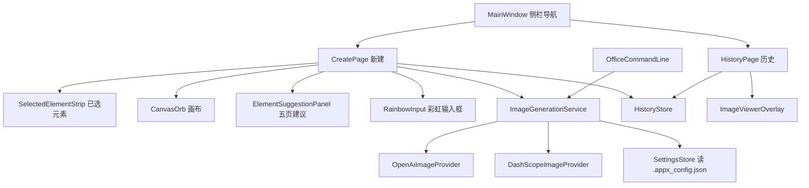

## 产品概述

在现有 intelligentSTUDIO 体系内新增一个独立 WinUI3 桌面应用「图乐园」：以元素拼贴加文字描述的方式驱动图像生成，视觉上采用深色 Mica 底、白色磨砂玻璃大圆、苹果智能配色的流动彩虹，形成克制且高完成度的 Fluent 体验。应用与 Dony、视觉智能、写作工具、通知智能等既有功能完全解耦，仅复用配置源与图标规范。

## 核心功能

- 侧栏导航：左侧仅「历史」「新建」两项，启动默认落在「新建」；切换带淡入位移过渡，禁止硬切。
- 新建页自上而下四段：已选元素栏、中央画布、元素建议区、底部输入栏。
- 元素建议区：5 页、56 个圆形元素（自然场景、主题氛围、表情、角色、服饰配件），每页两行，照搬参考截图的顺序与图标；左右圆形翻页按钮 + 页码指示点。
- 已选元素栏：点击建议元素后从左到右追加圆形小图标；输入框发送的文字生成药丸形元素（过长以省略号裁切，可添加多个）；元素右上角小关闭按钮；进场放大弹性、退场缩小。
- 彩虹输入框：标准 WinUI 矩形输入框，背后一层不规则流动的五色彩虹（红、紫、黄、蓝、粉），向外轻微渐变溢出；聚焦或有内容时 1 秒淡入，失焦且为空时 1 秒淡出；右侧线描箭头发送按钮，回车等效。
- 风格选择：任意风格、漫画、插画、表情、素描、写实，六项下拉。
- 生成按钮：点击后输入框彩虹淡出并开始生成；生成期间禁用重复提交。
- 中央画布：白色磨砂玻璃大圆 + 柔和投影；生成中圆内下方显示极简蓝色圆角进度条，圆外出现从底部起逆时针旋转的流动彩虹光边（向内延伸、长度与透明度呼吸变化、比圆稍大）；完成后圆扩展为圆角正方形展示结果，右侧出现「共享」「保存」；完成后仍可增删元素再次生成。
- 历史页：大图磁贴网格展示已保存作品；点击放大查看并支持缩放，「共享」「保存」可用；空态有引导文案。
- 保存：写入用户图片库 `Pictures\图乐园\` 并更新索引，同时弹出系统文件保存对话框另存一份。
- 生图配置沿用「STUDIO设置」中的图像模型配置，支持 OpenAI 兼容与通义万相两种协议自动识别。
- 预留 Office 插件调用入口：命令行静默生成并落盘，供后续 Word/Excel/PowerPoint 插件直接调用。

## 技术栈

- 运行时与 UI：.NET 8 + WinUI 3（Windows App SDK 1.6.250205002），与 `settings-app/DonySettings.csproj` 完全同构：`WindowsPackageType=None`、`WindowsAppSDKSelfContained=true`、`RuntimeIdentifier=win-x64`、`Platforms=x64;ARM64`。
- 动效：XAML Storyboard（尺寸/位移/透明度）+ `Microsoft.UI.Composition`（渐变笔刷、几何裁剪、旋转）。
- 图像与文件：`BitmapImage` / `SoftwareBitmapSource`、`Windows.Storage.Pickers.FileSavePicker`、`System.Text.Json`。
- 网络：`System.Net.Http.HttpClient`（共享静态实例 + 每次请求独立 `CancellationTokenSource`）。
- 构建：`dotnet build playground-app\ImagePlayground.csproj -c Debug -p:Platform=x64`，配套 `run-playground-app.bat`（照抄 `run-settings-app.bat`）。

## 实现策略

### 1. 工程与窗口

新建 `playground-app/` 独立工程（`AssemblyName=ImagePlayground`，`ApplicationIcon=..\Logo\图乐园.ico`），照搬 settings-app 的 `app.manifest`（PerMonitorV2、Win10 supportedOS、不要求管理员）与窗口五件套：Mica 背景、DWM 圆角（`DwmSetWindowAttribute` 33→2）、`ExtendsContentIntoTitleBar` + 自绘标题栏、`AppWindow.SetIcon("图乐园.ico")`。初始尺寸 1180×760，启动时居中。

### 2. 配置读取

整份复制 `settings-app/Services/SettingsStore.cs`（`FindRepoRoot()` 向上找 `package.json`+`backend`，命中 `.appx_config.json`；兜底 `%APPDATA%\IntelligentStudio\config.json`），保留 `GetString/GetBool/GetInt/Set/Save`。只读生图三项 `IMAGE_API_BASE` / `IMAGE_API_KEY` / `IMAGE_MODEL`，新增 `IMAGE_PROVIDER`（`auto|openai|dashscope`，缺省 `auto`）。

### 3. 生图服务（双适配）

- 统一契约 `IImageGenerationService.GenerateAsync(request, progress, ct)`，返回 `byte[]` PNG 与最终提示词；失败抛 `ImageGenerationException`（含中文可读原因与 HTTP 状态码）。
- OpenAI 兼容：`POST {base}/v1/images/generations`，body `{model, prompt, n:1, size:"1024x1024", response_format:"b64_json"}`；解析 `data[0].b64_json`，缺失时回退下载 `data[0].url`。base 已含 `/v1` 时不重复拼接。
- DashScope（通义万相）：`POST {base}/api/v1/services/aigc/text2image/image-synthesis`，头 `X-DashScope-Async: enable`，body `{model, input:{prompt}, parameters:{size:"1024*1024", n:1}}`；取 `output.task_id` 后每 2 秒轮询 `GET {base}/api/v1/tasks/{id}`，直到 `SUCCEEDED`（下载 `output.results[0].url`）或 `FAILED`。
- 自动识别：`IMAGE_PROVIDER=auto` 时，base 含 `dashscope` 或 model 以 `wanx`/`qwen-image` 开头 → DashScope，否则 OpenAI；显式配置优先。
- 健壮性：总超时 180 秒（创建 30 秒）；429/5xx 退避重试 2 次；错误信息映射为中文；密钥不入日志。
- 提示词合成：`PromptComposer` 将元素名、文字元素与风格拼为中文提示词，例如「一幅插画，画面包含：机器人、森林、日落。要求：……；整体构图完整、主体突出、高细节」，风格后缀集中维护在 `StylePreset` 表，便于扩展。

### 4. 彩虹与光边（Composition）

以 `dony-app/Controls/GlowChatBox.xaml.cs` 为唯一可参考的 Composition 范式（`CompositionLinearGradientBrush` + `MappingMode=Relative` + 多层 `CompositionSpriteShape` + `ElementCompositionPreview.SetElementChildVisual`），并遵循 rainbow-loading-pill 的参数化思路：

- 输入框：宿主 Grid 内放 `GlowHost`，输入框透明背景叠在上层；三层渐变描边（粗 8/5/3、透明度 0.22/0.42/0.7）以不同周期平移 `StartPoint/EndPoint` 形成不规则流动；整体 `Visual.Opacity` 用 1 秒 CubicEase 淡入淡出；宿主 `Margin="-10"` 让彩虹向外溢出，`IsHitTestVisible=false`。
- 生成光边：`CompositionEllipseGeometry` + `CompositionMaskBrush`（彩虹渐变作 Source、线性透明带作 Mask）截出弧段，`Visual.RotationAngleInDegrees` 从 90° 线性递减至 -270° 实现自底部逆时针旋转；动画 Mask 渐变端点改变弧长、动画容器 `Opacity` 0.55↔0.95（1.6 秒 autoreverse）实现呼吸；外圈半径比白圆大 8px，另加一层向内淡出的次级弧表现「向内」。

### 5. 圆到方形的形变

结果容器固定 560×560，图片 `UniformToFill` 铺满；通过 `ElementCompositionPreview.GetElementVisual(host).Clip = compositor.CreateGeometricClip(roundedRectGeometry)`，对几何的 `Size`（420→560）与 `CornerRadius`（210→40）同时做 `Vector2KeyFrameAnimation`（480ms，`0.22,1,0.36,1` 缓动），实现圆形裁剪平滑扩为圆角正方形，再配 1.0→1.02→1.0 的轻微回弹。生成开始时反向收缩回圆形并淡出旧结果。

### 6. 存储、分享与保存

- 历史：`Environment.GetFolderPath(MyPictures)\图乐园\`，文件 `yg_yyyyMMdd_HHmmss_xxxx.png`，`index.json` 存 `{id,fileName,prompt,styleKey,elementNames,createdAt,size}`；写入用临时文件 + `File.Move(overwrite)` 原子替换，`SemaphoreSlim` 串行化。
- 磁贴加载用 `BitmapImage` 配 `DecodePixelWidth=400`，避免 1024px 原图占内存。
- 分享：`IDataTransferManagerInterop`（`GetForWindow` + `ShowShareUIForWindow`）绑定窗口句柄；不可用时回退为复制图片到剪贴板并提示。
- 保存：先落库到图片库，再 `FileSavePicker` + `InitializeWithWindow` 让用户另存。

### 7. Office 接口

`OfficeCommandLine` 在 `App.OnLaunched` 最先解析 `Environment.GetCommandLineArgs()`：命中 `--office` 则不创建窗口，直接调 `IImageGenerationService` 生成、写入 `--out` 指定路径，按结果设置 `ExitCode`（0/1）后 `Exit()`；支持 `--prompt`、`--style`、`--size`、`--elements`、`--error-out`。`IImageGenerationService` 与 `PromptComposer` 均为 public，供后续宿主复用。

### 8. 错误与空态

未配置图像模型时，画布内显示提示卡与「打开 STUDIO 设置」按钮（经 `SettingsStore.RepoRoot` 定位 `DonySettings.exe`，缺失则运行 `run-settings-app.bat`）；生成失败保留已选元素，显示可重试信息条；按 Esc 取消进行中的请求。

## 系统架构



## 实施要点

- **性能**：`HttpClient` 静态复用；图片一律先落临时文件再用 URI 加载，避免大数组反复解码；建议区用 `ItemsRepeater + UniformGridLayout`（固定 6 列 2 行）而非 56 个常驻控件；翻页只重绑当前页 12 项；历史网格依赖虚拟化与 `DecodePixelWidth`。生成过程只在 5 个阶段点更新进度，避免高频 UI 调度。
- **线程**：网络与解码在后台线程；所有 UI 更新经 `DispatcherQueue.TryEnqueue`；取消用 `CancellationTokenSource`，页面关闭时级联取消。
- **日志**：`AppLog` 追加到 `%LOCALAPPDATA%\IntelligentStudio\图乐园\log.txt`（超 256KB 轮转），仅记录时间、阶段、HTTP 状态与异常类型，绝不写密钥或完整提示词。
- **影响面控制**：只新增 `playground-app/`、`scripts/`、`run-playground-app.bat`；对既有代码的唯一改动是 `settings-app/Views/ModelsPage.xaml(.cs)` 增补 `IMAGE_PROVIDER` 下拉并更新那句已过期的「图像模型尚未接入」提示，其余键与逻辑保持不变，确保 Dony、视觉智能、写作工具、通知智能零回归。
- **兼容性**：Window App SDK 自包含 + 非打包模式，必须使用 `ms-appx:///Assets/Elements/xxx.png` 绝对地址引用内置图（解包应用下相对路径解析失败，`LogoIcon.cs` 已实测）；中文路径用 `new Uri(path)` 处理。

## 目录结构

```
d:/OpenCode/APPXInteligent/
├── playground-app/
│   ├── ImagePlayground.csproj            [NEW] 工程定义：net8.0-windows10.0.19041.0、WindowsPackageType=None、自包含、ApplicationIcon 指向 ..\Logo\图乐园.ico、复制 ico 与 Assets\Elements\* 到输出目录。
│   ├── app.manifest                      [NEW] 照抄 settings-app：PerMonitorV2 DPI、Win10 supportedOS、assemblyIdentity=ImagePlayground.app、不申请管理员。
│   ├── App.xaml                          [NEW] 合并应用资源：深色主题、RainbowBrush（红#FF453A/紫#BF5AF2/黄#FFD60A/蓝#0A84FF/粉#FF375F）、标题与次要文字样式、卡片圆角 16。
│   ├── App.xaml.cs                       [NEW] 先解析 Office 命令行（命中则静默执行并退出），否则创建 MainWindow 并 Activate；暴露静态 MainWindow 供分享取句柄。
│   ├── MainWindow.xaml                   [NEW] 自绘标题栏 + 左侧 NavigationView（仅「历史」「新建」，取消设置项与返回键，OpenPaneLength=200）+ 内容 Frame。
│   ├── MainWindow.xaml.cs                [NEW] 复刻五件套（Mica/圆角/标题栏/图标/尺寸居中）；页面切换时调用页面的 ReloadAsync；淡入位移过渡 220ms。
│   ├── Views/
│   │   ├── CreatePage.xaml/.cs           [NEW] 新建页四段布局；维护已选元素集合、风格选择、生成状态机（Idle/Generating/Done/Error）；驱动 CanvasOrb 与 RainbowInput；Esc 取消；生成完成后保留结果直到下次生成。
│   │   ├── HistoryPage.xaml/.cs          [NEW] 磁贴网格（ItemsWrapGrid 自适应列宽、圆角 16、悬停放大 1.02 与阴影）、空态引导、加载索引并去重排序。
│   │   └── ImageViewerOverlay.xaml/.cs   [NEW] 全屏遮罩 + 缩放层显示大图（ScrollViewer ZoomMode=Enabled，0.5–4 倍），右上关闭，右侧「共享」「保存」；打开 280ms 缩放淡入，关闭 180ms 反向。
│   ├── Controls/
│   │   ├── RainbowInput.xaml/.cs         [NEW] 标准矩形 TextBox（圆角 8、高 48、透明底）+ Composition 彩虹宿主 + 右侧线描箭头 Path 发送按钮；聚焦/非空 1s 淡入，失焦且空 1s 淡出；Enter 发送；提供 FadeOutAsync 供生成时调用。
│   │   ├── CanvasOrb.xaml/.cs            [NEW] 420×420 白色磨砂圆（AcrylicBrush TintColor=White + FallbackColor 兜底 + ThemeShadow Translation 40）；生成中蓝色 4px 圆角进度条与逆时针彩虹弧；完成后按几何裁剪动画扩为 560 圆角方形并显示结果图；右侧浮出「共享」「保存」按钮。
│   │   ├── ElementChip.xaml/.cs          [NEW] 圆形/药丸两态元素控件：圆形显示裁切图、药丸显示文字（TextTrimming=CharacterEllipsis，MaxWidth 176）；右上角小 X；进/出场 Storyboard。
│   │   ├── SelectedElementStrip.xaml/.cs [NEW] 横向 ScrollViewer 承载已选元素，按添加顺序从左排列；新增时新 chip 放大弹入并自动滚动到可见；删除时缩小淡出后再移除。
│   │   └── ElementSuggestionPanel.xaml/.cs [NEW] 5 页建议区：每页 ItemsRepeater（MaximumRowsOrColumns=6、两行），左右圆形翻页按钮 + PipsPager；翻页按方向做 24px 位移 + 淡入淡出（260ms）；元素圆形悬停放大 1.06。
│   ├── Models/
│   │   ├── PlaygroundElement.cs          [NEW] id、中文名、图片相对路径、页码、提示词名。
│   │   ├── ElementChipModel.cs           [NEW] 已选项模型：Kind(Circle/Text)、Element、文本、唯一 Key，支持同元素重复添加与去重判断。
│   │   ├── GenerationContracts.cs        [NEW] GenerationRequest / GenerationResult / ImageGenerationException / IImageGenerationService。
│   │   ├── HistoryEntry.cs               [NEW] 历史条目记录（与 index.json 字段一一对应）。
│   │   └── StylePreset.cs                [NEW] 六个风格键、中文名与提示词后缀映射（任意/漫画/插画/表情/素描/写实）。
│   ├── Services/
│   │   ├── SettingsStore.cs              [NEW 复制] 原样复制并在读取处新增 IMAGE_PROVIDER 缺省 auto；保证配置路径解析与设置 APP 一致。
│   │   ├── ElementCatalog.cs             [NEW] 解析 Assets/Elements/manifest.json，按页返回元素；图片地址统一拼 ms-appx:///。
│   │   ├── PromptComposer.cs             [NEW] 组合元素名、文字元素、风格后缀为中文提示词；过滤空白与重复，长度上限 1200 字符。
│   │   ├── ImageGenerationService.cs     [NEW] 选择 provider、统一超时/重试/取消、把字节写入临时文件并返回结果；错误转中文。
│   │   ├── OpenAiImageProvider.cs        [NEW] /v1/images/generations 请求与 b64_json/url 双解析。
│   │   ├── DashScopeImageProvider.cs     [NEW] 异步任务创建 + 2s 轮询 + 结果下载。
│   │   ├── HistoryStore.cs               [NEW] 图片库目录创建、原子写索引、增删查、并发保护。
│   │   ├── ShareService.cs               [NEW] 窗口级分享面板，失败回退剪贴板。
│   │   ├── SaveService.cs                [NEW] FileSavePicker 另存 + 复制到图片库。
│   │   ├── SettingsLauncher.cs           [NEW] 定位并启动 DonySettings.exe（缺失时运行 run-settings-app.bat），用于未配置引导。
│   │   ├── OfficeCommandLine.cs          [NEW] 参数解析、静默生成、退出码与 --error-out 写入。
│   │   └── AppLog.cs                     [NEW] 轻量日志与轮转，禁止记录密钥。
│   ├── Interop/
│   │   └── DataTransferManagerInterop.cs [NEW] IDataTransferManagerInterop COM 声明与窗口级 DataTransferManager 获取。
│   ├── Assets/Elements/                  [NEW] 56 个 128×128 圆形透明 PNG + manifest.json（id/名称/页码/提示词）。
│   └── design/                           [NEW] 5 张源截图（ASCII 命名）与 contact-sheet.png 校验图。
├── scripts/
│   └── crop-playground-icons.ps1         [NEW] System.Drawing 裁切脚本：按页网格定位圆心、100px 边长裁切、4 倍超采样椭圆遮罩、缩放至 128px 输出；生成 manifest 与 7×8 拼版校验图。
├── run-playground-app.bat                [NEW] 照抄 settings-app 启动脚本，改 PROJ/EXE/标题。
└── settings-app/Views/ModelsPage.xaml(.cs) [MODIFY] 图像模型卡片新增「协议」ComboBox（自动识别/OpenAI 兼容/通义万相），读写 IMAGE_PROVIDER；把「尚未接入」提示改为占位说明，其余保持不变。
```

## 关键代码结构

```
public sealed record GenerationRequest(
    string Prompt,
    string StyleKey,
    IReadOnlyList&lt;PlaygroundElement&gt; Elements,
    int Size = 1024);

public sealed record GenerationResult(byte[] PngBytes, string FinalPrompt, string Provider);

public interface IImageGenerationService
{
    Task&lt;GenerationResult&gt; GenerateAsync(
        GenerationRequest request,
        IProgress&lt;double&gt;? progress,
        CancellationToken ct);
}
```

```
public sealed record HistoryEntry(
    string Id,
    string FileName,
    string Prompt,
    string StyleKey,
    IReadOnlyList&lt;string&gt; ElementNames,
    DateTimeOffset CreatedAt,
    int Size);
```

## 设计基调

以深色 Mica 为底、白色磨砂玻璃为主视觉、苹果智能五色流光为唯一高饱和元素，走「极少装饰 + 高质感材质 + 精准动效」路线。全部圆角化：卡片 16、按钮 10、输入框 8、磁贴 16。界面除彩虹外不出现第二种强调色，蓝色仅用于进度与主操作。

## 页面规划（3 屏 + 2 状态）

### 1. 新建页（默认）

- **侧栏**：宽 200，透明叠在 Mica 上；顶部「图乐园」标题与一行 BETA 小字；「历史」「新建」两项，选中项为半透明圆角高亮 + 左侧 3px 彩虹短条。
- **已选元素条**：高 76，横向滚动；圆形元素 56px 带白边，文字元素为深色药丸内浅色文字；右上角 18px 关闭点，悬停变实心。
- **中央画布**：420px 白色磨砂大圆居中，投影柔和下沉 40px；空态圆内为极淡的元素拼贴水印与一行提示「选择下方元素，或直接描述画面」。
- **元素建议区**：两行各 6 个，圆形 64px + 12px 中文标签；左右各一枚半透明圆形箭头，底部 5 个页码点；整体距底栏 24px。
- **底部输入栏**：彩虹输入框自适应宽度（最小 420）、风格下拉 132、生成按钮 108×44 主色实心；下方 8px 处灰色小字「BETA 版「图乐园」可能产生意外结果。」
- **生成态**：圆内下方 220×4 蓝色圆角进度条；圆外彩虹弧逆时针旋转并呼吸；输入栏与建议区降至 0.55 透明度但保持可交互，生成按钮转为「生成中」并禁用。

### 2. 历史页

- **页头**：标题「历史」+ 作品数量次要文字，右侧「刷新」线性图标按钮。
- **磁贴网格**：自适应列（最小 260px），方形圆角 16 磁贴，图片铺满 + 底部 48px 渐隐信息条（风格与日期）；悬停上浮 4px、放大 1.02、阴影加深。
- **空态**：居中大号线性图片图标 + 「还没有作品」+ 「去新建」文字按钮。
- **查看器**：全屏 55% 黑遮罩，图片最大 78% 视口并支持滚轮缩放；右上圆形关闭按钮；右侧竖排「共享」「保存」两枚玻璃质感按钮，280ms 缩放淡入、180ms 反向退出。

### 3. 完成态（新建页内）

结果以圆角方形（最大 560）呈现，圆角 40，四周留白；右侧浮出「共享」「保存」玻璃按钮；元素条与建议区保持可用，便于继续修改后再次生成。

## 交互与动效

统一 220–320ms、指数减速曲线（0.16,1,0.3,1）；元素进场 0.4→1.06→1 弹入并淡入，退场 1→0.7 缩小淡出；翻页 24px 方向位移 + 交叉淡入；圆变方 480ms 几何裁剪 + 轻微回弹；所有悬停 120ms 过渡；禁止任何硬切。

## Agent Extensions

### Skill

- **rainbow-loading-pill**
- Purpose: 提供彩虹流光输入框与沿边框旋转加载光边的参数化实现思路（渐变停点、层数厚度、旋转与呼吸节奏）。
- Expected outcome: 输入框彩虹溢出与生成态光边在 WinUI3 Composition 下达到一致的流动质感与呼吸节奏，且两者共用一套色板与参数。
- **animate**
- Purpose: 决定元素药丸进场/退场的时序、缓动与中断策略，以及圆到方形形变的时长与曲线。
- Expected outcome: 所有出现、隐藏、放大缩小均有明确曲线与时长，无硬切、无抖动，快速飞入且末尾减速。
- **apple-design**
- Purpose: 校准磨砂玻璃材质、留白比例、层级阴影与克制动效，使整体接近苹果智能的质感。
- Expected outcome: 白色磨砂圆、深色背景与彩虹的对比关系协调，视觉上呈现高级、安静的观感。