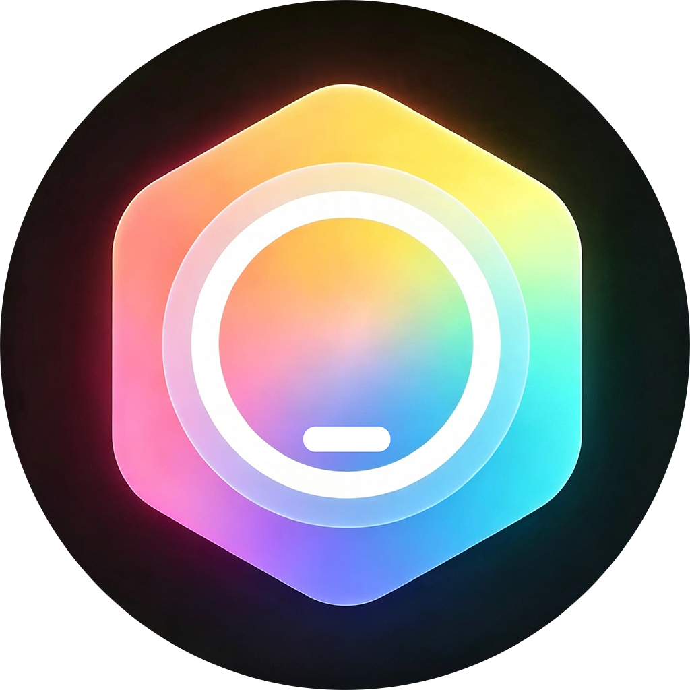
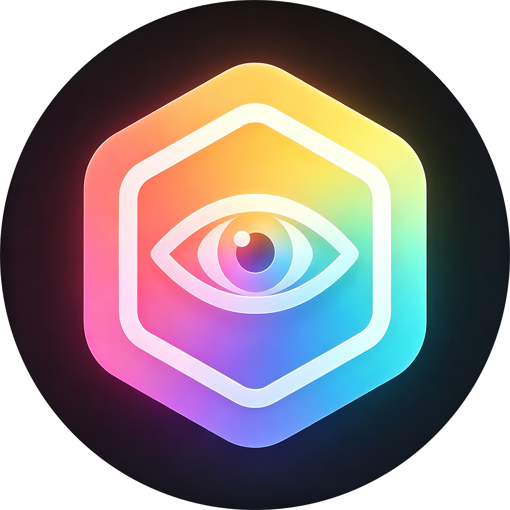
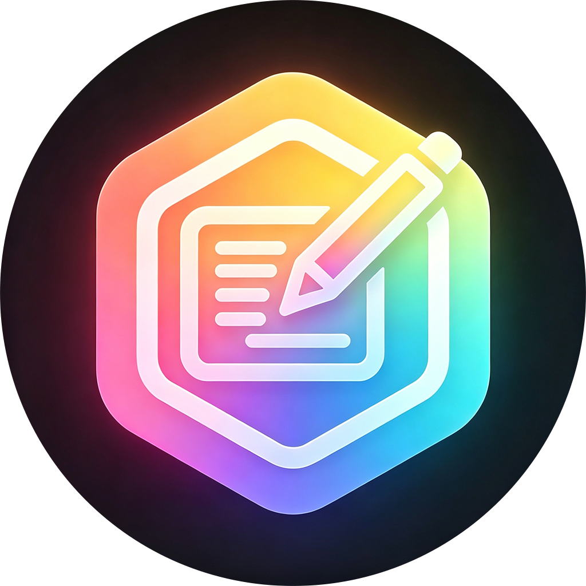
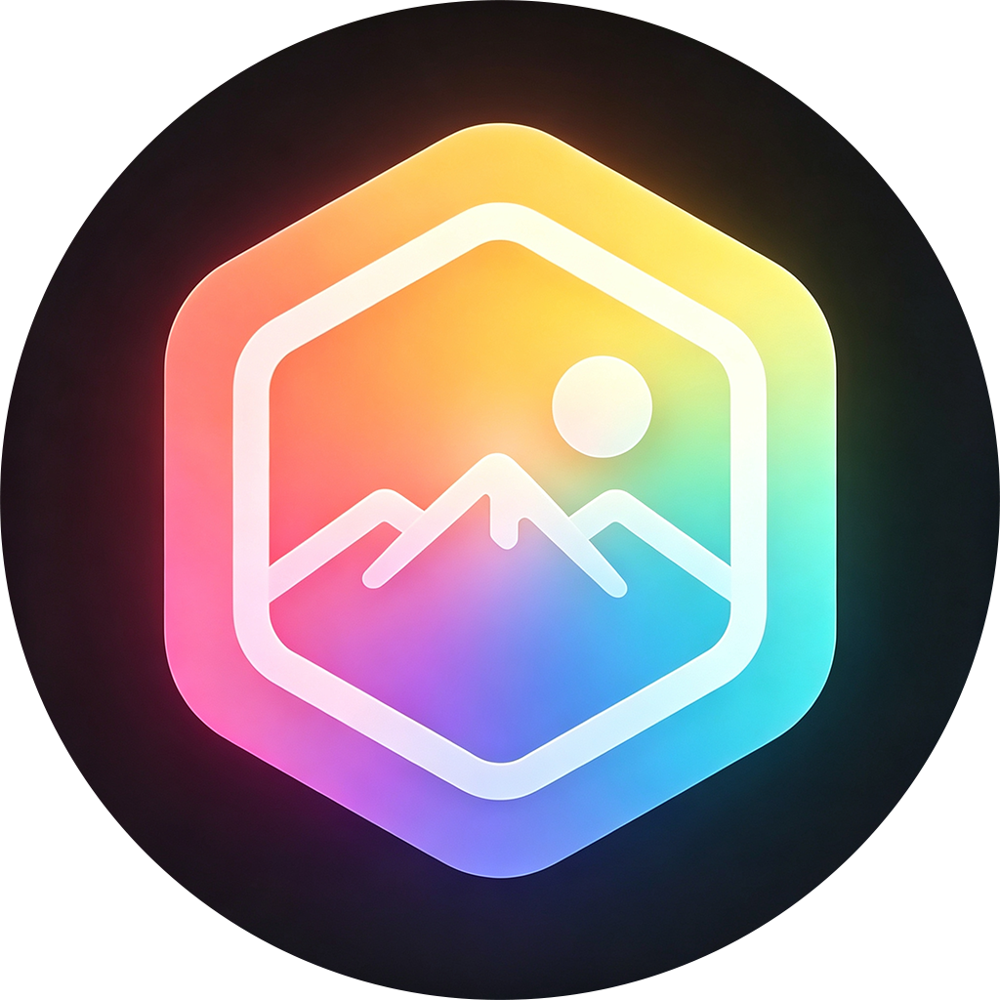
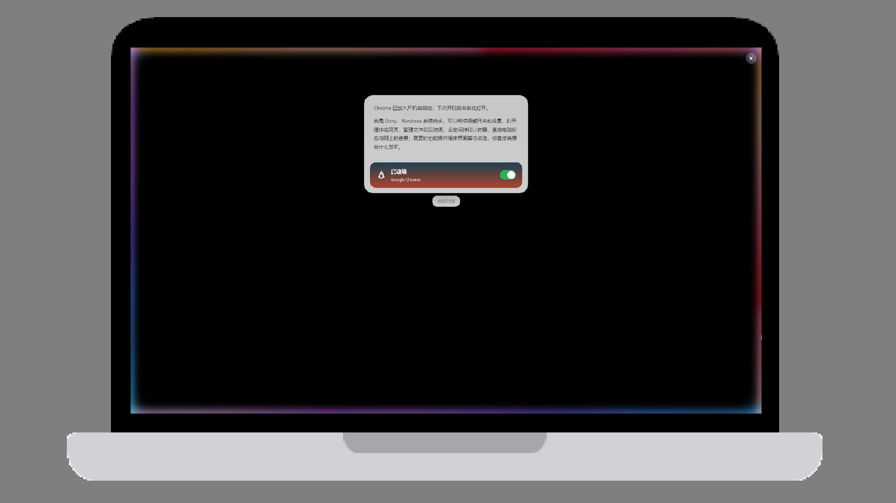
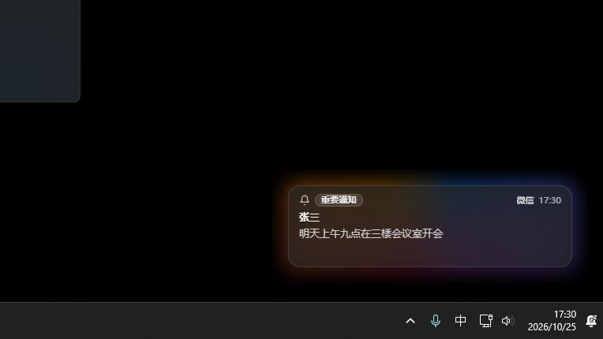
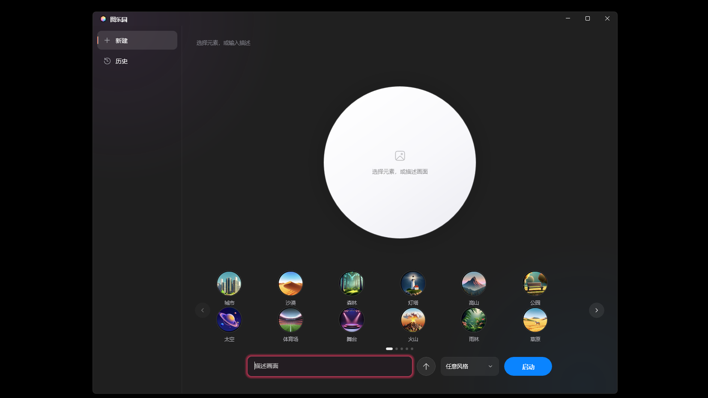

<p align="center">
  
</p>

<h1 align="center">intelligentSTUDIO</h1>

<p align="center">智能工作室 · Windows 上更好的苹果智能</p>

<p align="center">
  
  
  
  
  
</p>

类 Windows 系统级人工智能助手。将对话、视觉理解、写作、图像与通知能力深度融入 Windows 系统生态，提供接近原生系统能力的本地交互体验。

核心助手名为 **Dony**——一个实时唤醒、可操作系统级任务的 Agent，支持快速模式与任务模式，优先通过 Windows API、Shell、MCP 等直接型操作完成任务，而非间接的 GUI 点击。

## 功能特性

| | 功能 | 说明 |
| :---: | --- | --- |
|  | **Dony 系统级助手** | `Alt+Space` 唤醒键入模式、`Alt+D` 唤醒语音模式（通知中心菜单），唤醒动画为类似 Apple 智能的彩虹跑马灯；通过 Function Calling 调用工具，完成文件读写、应用启停、系统开关（蓝牙 / WiFi / 音量 / 亮度 / 热点 / 节能等）、剪贴板、窗口管理、计划任务、闹钟计时器等操作；支持长按长期记忆，并可直接点击、滑动与拖拽屏幕上的内容。 |
|  | **视觉智能** | `Alt+V` 或通知中心菜单框选屏幕区域，理解内容、翻译、提取文字、识别物体或搜索物体。 |
|  | **书写辅助** | 选中文字后将鼠标移到文字开头处，点击标签，然后选择校对、重写、调整语气或归纳为表格；`双击 Ctrl` 直接打开改写面板。 |
|  | **通知智能** | 同一应用的多条通知合并为一条摘要；智能勿扰模式下仅重要通知弹出提醒。 |
|  | **照片编辑器** | 裁剪、滤镜、消除、扩展与重构。 |
|  | **图乐园** | 选择元素，结合提示词与风格生成图片。 |
| | **Edge 扩展** | 在浏览器内使用视觉智能，并使用 Dony 整理标签页、收藏夹与书签。 |
| | **Office 插件** | 在 Word、Excel 和 PowerPoint 中使用书写辅助与图乐园，可以根据上下文自动生成插图。 |
| | **首次启动引导** | 安装后首次启动的欢迎与设置流程，完成后进入 STUDIO 设置。 |

## Dony

Dony 是 intelligentSTUDIO 的核心助手：`Alt+Space` 唤醒键入模式、`Alt+D` 唤醒语音模式（通知中心菜单）。

### 卡片系统

Dony 的每次操作结果以**卡片**呈现——**每张卡片就是被操作的项目本身**：一个文件、一个开关、一台设备、一条天气资讯。用户看到的不是"操作日志"，而是对象本身。

| 卡片元素 | 含义 |
| --- | --- |
| 标题 | 项目名（「WiFi」「报告.docx」「计时器」） |
| 副标题 | 状态或数值（「已打开」「5:00」「32°C」） |
| 图标 | 对应类型的线描图标（24×24，见下文「图标」章节） |
| 主图（可选） | 网站截图、天气图等 |
| 渐变底色 | 按 `theme` 生成，同类卡片视觉一致 |
| 操控项（可选） | `switch` 开关 / `slider` 滑块 / `segments` 三段式 |

设计要点：

1. **卡片即对象**：卡片不是一条"已打开 WiFi"的文字记录，而是「WiFi」这张卡本身（带开关）。卡片消亡 = 对象状态结束。
2. **双向反馈**：点开关、拖滑块、选档位 → 发给后端 → 后端回读系统真实值回传 → 系统未接受则自动翻回，避免"点了不生效"的错觉。
3. **与文字同一节奏**：卡片接在正文之后，共用同一条飞入序列（从下方飞入、步长统一）；最后一张卡片落地 = 结果框扩展到最终高度，没有二次跳变。
4. **操控项按类型分配**：布尔状态用开关（WiFi / 蓝牙 / 勿扰），连续值用滑块（音量 / 亮度），固定档位用三段式（电源模式：节能 / 均衡 / 高性能）。
5. **特殊卡片**：
   - 天气卡片：图标 + 逐项明细（降雨概率、风力、湿度）
   - 网址卡片：左侧网站主图，点击用默认浏览器打开并收起 Dony
   - 计时器 / 闹钟：副标题实时走秒
6. **图标规范**：24×24 画布、stroke 1.7、圆头线端、`currentColor`，几何按 SF Symbols 骨架重画，保证同一排视觉重量一致。

## 照片编辑器

照片编辑器是独立的 WinUI3 应用（`photo-app`），提供四项核心能力：

### 消除

点选画面中的物体，自动识别其轮廓并擦除。**轮廓识别依赖 SAM（Segment Anything Model）**：编码器提取图像特征，解码器按点选提示输出精确掩码。

擦除内容有两种生成方式：

- **内置模型**：本地 Moebius 修补模型直接补全被擦除区域（离线可用）
- **API 接口**：调用配置的图像编辑模型（OpenAI 兼容接口）生成填充内容

### 扩展

以原图为基准向外扩展画布，由生成式模型补全新增区域，用于调整构图或补足边缘。

### 重构

由**单张照片**生成 3D 点云图（SHARP 模型，Node + onnxruntime-node + WebGPU 推理）：

1. 单图重建为高斯点云
2. 用户选择新的观察视角
3. 生成式模型补齐视角变换后的空缺区域，重新完成照片构图

## 界面预览

<p align="center">
  
  
  
</p>

## 系统要求

### 安装版（推荐，无需 Node / Python / .NET）

安装包已内置全部运行时，终端用户**不需要**安装 Node.js、Python 或 .NET：

- Electron 运行时（桌面壳）
- Python 运行时与全部依赖（PyInstaller `--onedir` 打包为 `intelligentstudio-backend.exe`）
- .NET 运行时（WinUI3 子应用为 `SelfContained=true`）

因此仅需：

- Windows 10 21H2 或更高版本，或 Windows 11。
- 显卡需支持 DirectX 12（部分视觉功能依赖）。
- WebView2 运行时（Windows 11 预装；Windows 10 若缺失需安装）。
- 约 4 GB 磁盘空间（含本地模型）。

### 源码运行（开发者）

需要以下工具链：

- Node.js 18+
- Python 3.10+（推荐 3.12）
- .NET 8 SDK（编译 WinUI3 子应用，`dotnet build` 自动还原依赖）

## 技术栈

### 桌面壳与前端

- **Electron 31**：主进程、全局快捷键、托盘、多窗口（覆盖层 / 托盘菜单 / 闹钟）
- **React + Vite + TypeScript**：覆盖层界面（唤醒动画、视觉面板、对话结果）
- **WebView2**：照片编辑器的 3D 场景渲染

### 后端

- **Python 3.12 + FastAPI + uvicorn**：8 个本地服务
- **PyInstaller（`--onedir`）**：打包为 `intelligentstudio-backend.exe`，通过 `--service <name>` 分发
- 端口：8766 语音 / 8767 Agent / 8768 视觉桥 / 8769 App API / 8770 通知 / 8771 Office 桥 / 8772 照片推理

### WinUI3 子应用

- **C# / .NET 8 + Windows App SDK**（`SelfContained=true`，不依赖目标机 .NET 运行时）
- 包含：设置、Dony 对话、图乐园、照片编辑器、首次引导

### 本地 AI 推理

| 能力 | 方案 |
| --- | --- |
| 语音识别 | sherpa-onnx（Zipformer 中英双语，流式） |
| 语音合成 | edge-tts（微软在线 TTS，无本地模型） |
| 通知摘要 / 分类 | ONNX Runtime（Qwen2.5-0.5B INT4 + bge-small-zh-v1.5） |
| 图像分割 / 修补 | ONNX Runtime（SAM / Moebius） |
| 3D 重构 | Node + onnxruntime-node + WebGPU（SHARP） |

### 系统集成

- **pywin32**（`win32gui` / `win32clipboard` / `win32api`）：窗口操作与剪贴板
- **uiautomation + comtypes**：全局选区监听、文本写回
- **winsdk**：Windows 通知监听与勿扰

### 打包与分发

- **electron-builder**：去模型安装包（NSIS 单 exe）
- **Inno Setup 6**：含模型安装包（`DiskSpanning` 分卷，突破单文件 4 GB 上限）
- **tar（bsdtar）**：模型包（ZIP64，支持超 2 GB）

## 目录结构

```
electron/         Electron 主进程与预加载脚本
src/              前端界面（React + Vite + TypeScript）
backend/          Python 后端（FastAPI 服务、Dony Agent、视觉 / 语音 / 通知 / 图片 / Office 桥接）
settings-app/     STUDIO 设置（WinUI3，模型 / MCP / 通知 / 通用）
dony-app/         Dony 对话（历史记录，WinUI3）
playground-app/   图乐园（WinUI3）
photo-app/        照片编辑器（WinUI3）
onboarding-app/   首次启动引导（WinUI3）
extension/        Microsoft Edge 扩展（视觉智能 + 标签页 / 收藏夹整理）
office/           Office 加载项（Word / Excel / PowerPoint）
scripts/          安装、构建与辅助脚本
models/           本地模型（语音 / 视觉）
assets/           图标与媒体素材
```

## 快速开始

### 安装版用户

> **GitHub 上的源码不包含模型文件**（超出仓库体积限制），模型只在 **Release** 中提供。
> Release 提供含模型的完整安装包（4 个分卷文件）。

1. 从 **Release** 下载全部 4 个文件：`intelligentstudio-full-0.1.0.exe` 与 `-1/-2/-3.bin`。
2. 把它们放在**同一目录**下，双击 `intelligentstudio-full-0.1.0.exe` 安装。
3. 安装完成后启动 `intelligentSTUDIO.exe`，首次启动会进入设置向导。
4. 按向导填写模型配置并完成引导即可。

### 源码运行（开发者）

1. 安装依赖：

   ```bat
   npm install
   pip install -r backend\requirements.txt
   ```

   建议使用虚拟环境：

   ```bat
   python -m venv .venv
   .venv\Scripts\python.exe -m pip install -r backend\requirements.txt
   ```

2. 一键启动：

   ```bat
   start.bat
   ```

   该脚本会清理旧进程、释放端口，依次拉起 Agent（8767）、Dony App API（8769）、Electron 前端（5173）。

   也可使用交互式启动脚本 `start.ps1`，在启动前输入模型接口地址、模型名与 API 密钥。

3. 快捷键：

   | 操作 | 快捷键 |
   | --- | --- |
   | Dony 键入模式 | `Alt+Space` |
   | Dony 语音模式 | `Alt+D` |
   | 视觉智能 | `Alt+V` |
   | 书写辅助 | 选中文字后 `双击 Ctrl` |

## 子应用（WinUI3，源码态）

> 安装版已内置编译好的子应用（`SelfContained`），无需 `dotnet build`。以下仅适用于源码运行。

各子应用为自包含、非打包的 WinUI3 应用，首次运行会自动执行 `dotnet build`：

```bat
run-settings-app.bat        STUDIO 设置
run-dony-app.bat            Dony 对话
run-playground-app.bat      图乐园
run-photo-editor.bat        照片编辑器
run-onboarding.bat          首次启动引导（可加 --step N 从第 N 页开始）
```

## 配置

- `.appx_config.json`（仓库根）：模型接口地址、API 密钥、模型名（主模型 / 视觉模型 / 图像模型 / 编辑模型）、MCP 服务、书写辅助与通知智能开关等。
- `%APPDATA%\Dony\settings.json`：Dony 语音（TTS）等运行时设置。
- 后端服务端口：

  | 端口 | 服务 |
  | --- | --- |
  | 5173 | Vite 前端 |
  | 8766 | 语音服务 |
  | 8767 | Dony Agent |
  | 8768 | 视觉智能桥接 |
  | 8769 | Dony App API（历史 / 语音 / 文件） |
  | 8770 | 通知服务 |
  | 8771 | Office 加载项本地桥 |
  | 8772 | 照片编辑器推理服务 |

## 浏览器扩展与 Office 插件

- Edge 扩展：`extension/`，在浏览器内提供视觉智能浮窗，并整理标签页、收藏夹与书签。
- Office 插件：`office/`，为 Word、Excel 和 PowerPoint 提供书写辅助与图乐园。

两者可在「STUDIO 设置 → 通用」页点击安装，或直接运行：

```bat
powershell -ExecutionPolicy Bypass -File scripts\install-edge-extension.ps1
powershell -ExecutionPolicy Bypass -File scripts\install-office-addin.ps1
```

## 图标

### 应用图标

<p>
  
  
  
  
  
  
</p>

| 图标 | 名称 | 用于 |
| :---: | --- | --- |
|  | intelligentSTUDIO | 主程序、STUDIO 设置、通知智能 |
|  | Dony | Dony 对话 |
|  | 视觉智能 | 视觉框选、Edge 扩展 |
|  | 书写辅助 | 书写辅助、Office 插件 |
|  | 图乐园 | 图乐园 |
|  | 照片智能编辑器 | 照片编辑器 |

### 结果卡片图标

Dony 结果卡片使用 24×24 线描图标（stroke 1.7、圆头线端、`currentColor`），共 28 个：

| 类别 | 图标 |
| --- | --- |
| 文稿 | `file` 文件 · `folder` 文件夹 · `link` 链接 |
| 通信 | `mail` 邮件 · `message` 消息 |
| 系统 | `cpu` 处理器 · `wifi` WiFi · `bluetooth` 蓝牙 · `volume` 音量 · `sun` 亮度 · `alarm` 闹钟 · `timer` 计时器 · `calendar` 日历 · `rocket` 启动 · `usb` 设备 · `clipboard` 剪贴板 · `window` 窗口 |
| 天气 | `cloud-sun` 多云 · `cloud` 阴 · `rain` 雨 · `snow` 雪 · `thunder` 雷 · `fog` 雾 · `wind` 风 · `moon` 夜间 |
| 其它 | `sparkle` 智能 · `trash` 删除 · `keyboard` 键盘 · `globe` 网络 |

## 许可证

本项目采用 **GNU General Public License v3.0**，完整文本见 [LICENSE](LICENSE)。

> 分发前请将各源文件头部与分发说明中的版权归属替换为实际作者或组织名称。

## 开发者

- 软件开发者：**方块AAA**（bilibili UP：**方x盒**，GitHub：**FangkuaiAAA**），个人和 AI 完成。
- 「照片编辑器」中的「照片重构」功能修改自 GitHub：**henjicc** 的 [Photo-Reframing](https://github.com/henjicc/Photo-Reframing) 项目（bilibili UP：**痕继痕迹**）。
